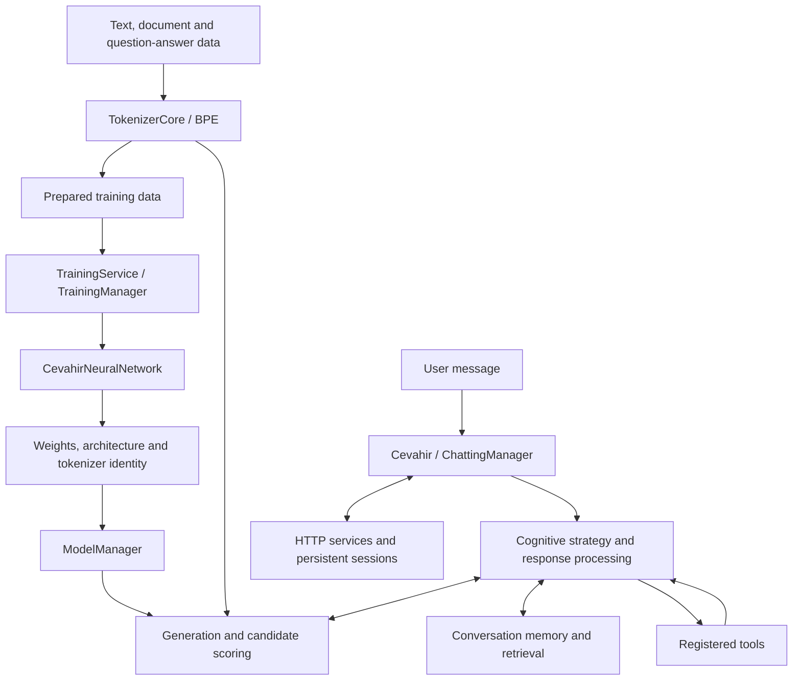
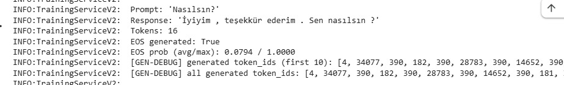
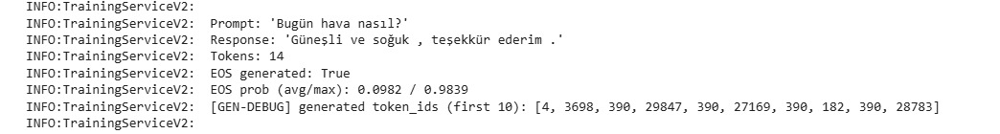
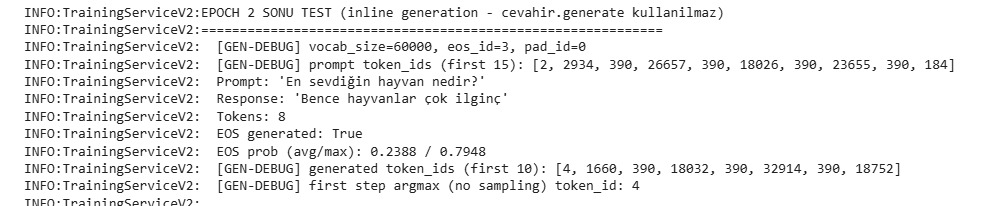
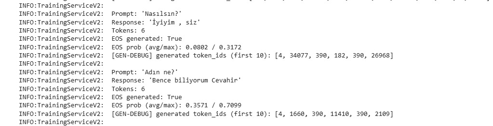
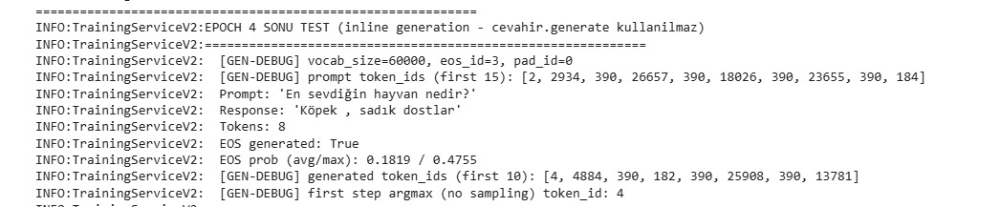
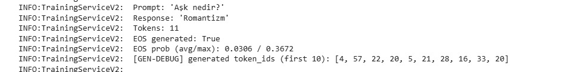

# 🍌 🇹🇷 🍌 Cevahir AI & Engine

**Daha Adil Bir Dünya Mümkün.**

[English](README.md) · [Türkçe](README-TR.md)

[Research archive DOI (always the latest version): 10.5281/zenodo.22864660](https://doi.org/10.5281/zenodo.22864660) · [v7: 10.5281/zenodo.24494960](https://doi.org/10.5281/zenodo.24494960) · [Research reports](docs/publications/README.md) · [The paper: Cevahir Zihin, a Living Evidence Mind](docs/research/living_evidence_mind_2026_11_24/PAPER.md)

> **Latest update — November 2026: Cevahir Zihin, a mind that learns by living. Not a Transformer.**
>
> The new model in this repository, Cevahir Zihin (`zihin/`, what `python -m zihin` runs), is not a neural network
> but a **Living Evidence Mind**. It has no weight matrices, embedding vectors, backpropagation or softmax attention.
> It keeps every relation as a tie and keeps each tie's evidence **by where it came from**: seen with its own eyes,
> told, imitated, its own act, inferred or imagined. It reads what to expect from a single rule:
> `e = c·(f − ½) + ½`. The earlier Transformer engine described below is still in the repository.
>
> - **The whole mind (new):** `python -m zihin` raises a mind with every mechanism below in use, and gives a mind you
>   load the ones it was raised without (`--kapat name` keeps one off; `--variant speaking` is the earlier default; the
>   `--ac name` in the entries below is the name of each mechanism). All of them together had never been measured:
>   the first time, the whole did worse than its parts in eight measured worlds. Each case was traced by leaving one
>   mechanism out at a time, and five new mechanisms came of it (F61 to F65, listed further down).
> - **Attention:** at each moment only seven units enter the focus (the **Seven-Place Focus**). There is no context
>   window: it never looks back over the past and reads only the ties of the units in focus, so the time per moment
>   grows only slowly as the mind grows (about 2 ms on a small mind, about 4 ms at 3 million ties).
> - **Forgetting:** while its ledger is kept, the evidence of any single experience can be taken back exactly
>   (**Exact Retraction**); in the program this covers what you typed in the current session (`!unut`).
> - **Recall from one reading:** a mind that read a set of documents once, given the first two words of a random
>   sentence, said a sentence it had read that begins with them in 145 of 200, and the rest of that very sentence in
>   60 of the 61 whose two words begin only one sentence (**Sequence Starts**, **Lived Exclusion**, **Exact
>   Relations**). The strongest small Transformer trained on the same documents for 50 minutes said a valid one in 41.
> - **Working memory (new, `--ac wholes`):** an utterance too long for its window is held as parts and answered
>   part by part (**Wholes**): a sequence it has heard answered is one item, and so is its answer. On SCAN's
>   add-jump split with commands of every length (7,706 test commands, answers of up to 48 actions) it answers
>   **7,706 of 7,706** after watching 8% of the training dialogues twice (six and a half minutes of life on one
>   core); a Transformer trained from scratch on the same dialogues answers 1. With **92 dialogues** (0.7% of the
>   training set, ten seconds of life) it answers 500 of a sample of 500. SCAN's length split (answers longer than
>   any it has seen): 500 of 500 (as first found 101; a Transformer 0). In a Turkish world it was not developed on
>   (jobs made of jobs), 492 of 492 (0 without it).
> - **A word's own share (new, `--ac told_apart`):** a word that was never said alone ("left", "right") answers with
>   what two dialogues that differ only in it differ in (**Told Apart**, Mill's method of difference). SCAN's
>   "around right" template split: 0 → 500 of 500. In a Turkish world it was not developed on, the first run 600 of
>   600; a new direction met in one dialogue is then used in every construction (600 of 600; a Transformer 7 of 200).
> - **Wanting to learn (new, `--ac open_claims`):** asked about a thing it never met, it notes that something it
>   does not know follows that item (**Open Claims**: a frame of its own asked for it and its record was empty), wants
>   that first, looks it up when you let it (`!kendini_gelistir`) and answers afterwards: of the 20 topics it wanted
>   most, 20 were the things it could not answer (0 without it), and asked again it answered 20 of 20.
> - **Deciding by itself when to look (new, `--ac look`):** in the silences of its online life it decides, by its
>   own evidence, to look up what it found it did not know: left alone after four questions it could not answer, it
>   looked up exactly those four and nothing else, read, saw for itself that the claim was met, answered 20 of 20
>   when asked again, and looked no more. When looking leads to nothing it stops by its own evidence. It reads only,
>   from what you give it (your own folder with `--kaynak`, the web unless `--agsiz`), and prints every page.
> - **The internet, dependably (new):** everything it reads from the web passes through one polite gate
>   (`zihin/ag.py`: it only reads, waits between requests, tries again when a service is busy, obeys robots.txt,
>   keeps what it fetched so it can be read again offline). `!ag` says what your machine can reach; `!oku_url` reads
>   pages by address. Live: asked about a real thing it never met, it looked it up on Wikipedia by its own decision
>   and answered with the page's first sentence.
> - **Many questions at once, nothing lost (new):** `!sor_hepsi` answers a file of questions at the same time, each
>   by the mind as it stands; the answers are word for word what it gives one after another (60 answers in parts
>   4.8 times sooner on 4 processors). Living is still one moment after another: a way to learn in parallel was
>   measured, lost recall on real text, and was taken out again.
> - **Not knowing:** it feels when it does not know (a measured inner state). How it says so is learned from the
>   people it lives with and from its data; the core holds no sentence for it.
> - **Dreams:** in sleep it dreams about the day's topics, and on later nights sorts which of its imaginings came out
>   true.
> - **Learning from consequences:** in a research test (six tiny functions, three candidate completions each) it
>   learned from test results alone to choose the completion that passes; writing new code is still open.
>
> **There is no separate training phase; the model learns in every conversation. Please speak to it kindly.**
>
> Theory and architecture: [docs/ZIHIN_THEORY.md](docs/ZIHIN_THEORY.md) · the paper:
> [PAPER.md](docs/research/living_evidence_mind_2026_11_24/PAPER.md) · measurements and negative results:
> [research/living_mind_2026_11_15/NOTES.md](research/living_mind_2026_11_15/NOTES.md)

### Run Cevahir Zihin on your computer

It needs Python 3.11 or newer. Linux / macOS:

```
git clone https://github.com/myylogic/cevahir-ai
cd cevahir-ai
python3 -m venv .venv && . .venv/bin/activate
pip install torch numpy           # optional: python-docx (Word), pypdf (PDF), pillow (images)
python -m zihin
```

Windows PowerShell:

```
git clone https://github.com/myylogic/cevahir-ai
cd cevahir-ai
pip install torch numpy
.\cevahir.ps1                     # if scripts are blocked: powershell -ExecutionPolicy Bypass -File .\cevahir.ps1
```

Start it inside the `cevahir-ai` folder. The program speaks Turkish: it first asks "Seninle konuşan kim?" (who is
talking to you?; type your name). On first start the mind is empty and knows no language; it learns by living with
you. If you have files to teach it, type these at the program's prompt, not in the shell (each command has an English
alias):

```
!oku my_documents/                # !read: .txt .md .docx .pdf documents, .json/.tsv dialogues, source code
!ogret dialogues.tsv              # !teach: each line question<TAB>answer, saved as UTF-8
!izle hello || hi                 # !watch: let it watch an exchange
!dogru  /  !yanlis                # !good / !bad: how you received its last answer
!uyu    !dusun <topic>   !kendin  # !sleep, !think, !introspect: dream, inner voice, introspection
!cik                              # !quit
```

While it is open it lives in its own time: it lives silent moments, thinks inwardly after ten seconds of silence and
sleeps after ten minutes (`--yasamsiz` turns this off); it says something only when its own decision produces words. The mind is saved at the end of every session to `~/.cevahir/zihin/cevahir.zihin`
(Windows: `%USERPROFILE%\.cevahir\zihin\cevahir.zihin`; `CEVAHIR_HOME` changes the folder; `--kaydetme` does not
save).

The minds raised so far lived the author's private Turkish data and are not in this repository. Your copy learns the
language you teach it with `!ogret` and `!oku`. For a language other than Turkish, start a new mind with `--dil diger`
so that capital letters are lowered without Turkish rules (a mind keeps the rule it was raised with). After a dozen
pairs it answers the questions it was shown; how much data a new language needs for questions it has not seen has
not been measured. A mind file carries what it has read, so do not share a mind raised on private documents.

---

**An open-source AI research engine: a new mind core that learns by living (Cevahir Zihin), alongside Turkish-specific tokenizer infrastructure, a Transformer language-model core and cognitive systems.**

I'm Muhammed Yasin Yılmaz. I built Cevahir to bring data preparation, model learning and the use of a trained model in conversation into one codebase. It includes its own BPE pipeline, a configurable PyTorch Transformer decoder, training and checkpoint management, generation, cognitive workflows, conversational memory, and application services.

I want developers, especially young people in Türkiye, to have a foundation they can inspect, train on their own data and extend with new capabilities. I share the implemented modules, my completed model training runs and their outputs as this work develops.

**My gift to Turkish youth. — Muhammed Yasin Yılmaz**

I am continuing Cevahir as an **open-source research and educational legacy**, with productization no longer its goal. The engineering work and research on learning throughout a system's operating life continue together.

## New core: Cevahir Zihin — a mind that learns while living (November 2026)

In November 2026 I started a new core, separate from the Transformer: **Zihin** (Turkish for "mind"). What I am after is not a fixed network but a mind that runs its own network while living, builds concepts from its experiences and measures what it builds. The Transformer engine and all earlier research remain below, unchanged.

**Why this is not a Transformer:**

| Transformer | Cevahir Zihin |
|---|---|
| train → freeze → use | learning is living: it learns at every moment, there is no separate training phase |
| fixed dimension, fixed vocabulary, embedding vectors | growing units and ties, open alphabet; no fixed dimension |
| next token by softmax | conviction: every belief has a strength and a source; if nothing accumulates to threshold, it stays silent |
| new knowledge damages old knowledge, retraining needed | new knowledge is added, old knowledge stays bit-identical |
| knowledge is spread over weights, a single example cannot be removed | while its ledger is kept, the evidence of a single experience can be retracted exactly from the core |
| no record of where a belief came from | every piece of evidence keeps its source (told, sensed, imitated, own act, inferred, imagined); trust in sources is learned |

**Measured results** (two generated worlds, 5 seeds; details in [results](research/living_mind_2026_11_14/RESULTS.md) and [notes](research/living_mind_2026_11_14/NOTES.md)):

- A first hearing is weak and conviction grows with hearings (c 0.41 after one, 0.78 after four or more); a correction weighs old evidence instead of deleting it (120/120).
- It finds hidden classes by itself (Jaccard 1.00).
- On instances never told the asked dimension, generalisation improves with age: 93% / 81% (two domains) after 600 experiences, 100% / 90% after 1500. The earlier reading rule got worse with age; eight failed attempts and the cause are recorded.
- No forgetting: facts learned early are bit-identical hundreds of experiences later; living a second domain does not disturb the first (10/10).
- The evidence of a single experience can be retracted exactly (10/10); this is exact for the evidence, not for the structure the experience created.
- It imitates first, then detaches from what it copied by its outcomes, while keeping the knowledge that others act so (T7).
- Against a small Transformer on the identical stream of experiences (5 seeds × 2 worlds, identical probes; Zihin in its "members" configuration): on instances never told the asked dimension Zihin reaches 90% / 97% and 75% / 95%; a Transformer trained online in one pass 67% / 57% and 60% / 50%; one trained to convergence on the whole stream 77% / 67% and 53% / 53%. A second domain lowers the one-pass Transformer's accuracy on the first from 0.85 to 0.74 and leaves Zihin's at 1.00. The configuration the chat program runs was not in this comparison and did poorly in these worlds (held-out 0.57 and 0.04 after 600 experiences); on 15 November two causes were found: these worlds let it speak into their stream, so it lived its own words between theirs, and a relation reading (F12's "next") took the members' agreement on a value. Listening while the world speaks, as in a chat, and with Exact Relations (F28), Sequence Starts and Lived Exclusion, it reaches 0.78 and 0.81, with members, exceptions and the hidden classes all at 1.00 (the "members" configuration's 0.93 in the first world is not reached). Retracting one experience takes 20–77 ms in Zihin and is exact; the Transformer's exact counterpart is retraining from scratch. This comparison is in the small-data, learn-while-living regime; the Transformers are small and the gap may close with far more data.
- Chat: it says what it watched, answers questions it never watched by relations ("what does a bird do" → "a bird sings"), stays silent when it knows nothing, and stops giving a copied answer once told it was wrong.
- It sees and hears (first versions): image and sound files are perceived by plain pixel and signal arithmetic, with no trained network, and recognised by resemblance. New images 73% / 83% / 67% right, new sounds 93% / 97% / 93% (chance 33%; 0% with resemblance off).
- Imagination (first form): it imagines by carrying a thought over to a structurally similar concept and scores every step for reality against lived evidence (T8).
- Sleep and dreams: asleep, it dreams about the last topic and the words it is unsure of. A dream is a chain of imaginings linked by association, and an image it saw with a word is "seen" again in the dream. Then it weighs its imaginings against what it has lived, says which earlier dreams came out true or false, and learns from this how far to trust its own imagination. A dream found false is not deleted; real evidence outweighs it.
- Not knowing, and thinking: when its turn comes with no answer at once, a silent moment passes, in which it may perceive its not knowing as an inner state, and it decides again; what it says is only what its own decisions emit. How it says that it does not know, and how it asks, are learned from the people it lives with and from its data. Until 15 November 2026 the chat program also had coded reflexes that spoke for the mind (it asked back an unknown word with '?', said a thought for it, and spoke first after a silence); they were removed on that day, so a new mind is silent until it has lived how to answer. Until 15 November 2026 the chat program also held scripted lessons about the mind and about saying "bilmiyorum", written by the developer; they were removed from the core at the owner's decision, and minds raised before lived them.
- Online life: from the moment a session starts it lives in its own time. Its words come out as it says them. In silence it lives silent moments (and says something only if its own decision produces words), thinks inwardly after 10 seconds and sleeps after 10 minutes; these two timings are an innate rhythm that may later be read from the mind's own evidence.
- Turkish structure (opt-in): with `--parca cevahir` a mind lives each word with its root, suffix and stem pieces from the repository's own tokenizer infrastructure, so words built alike resemble each other. Raised with pieces from birth, a mind grew about five times as many ties per moment and ran out of memory, so pieces are off by default.
- Learning code from its consequences (first test): on six tiny functions it first watches mostly wrong completions. Then the code it writes is actually run, and the test result comes back as a good/bad signal; when it hesitates it tries the alternative whose consequences it knows least. By round 4 it writes passing code for all six tasks; without the signal it stays at 0%, and without trying at 11%.
- Learning to learn (F24, off by default): from its own outcomes it learns how far a kind of "voice" can be believed (how many members speak, how much they agree), and it carries this into a new domain. Early learning speeds up in one direction (+0.058 ± 0.025; better in 7 of 10 lives) but not in the other; the result is mixed.
- Speed and memory: the core is 2–3.8x faster per moment with bit-identical results. Memory per tie went from 239 to 69 bytes: on a mind with 3 million ties the core shrank from 777 MB to 223 MB and the file from 930 MB to 377 MB. Old mind files are converted on load. The memory layout costs 13–32% per moment.
- A self: an innate "self" unit is present in every moment the mind speaks or thinks. By introspection it reads what it has said and thought, and how much, in its own life.
- Recall of what was read once (F26 Sequence Starts, F27 Lived Exclusion): how a word went on where a sequence began with it is now kept apart from how it went on anywhere, and what a situation was itself lived to be followed by counts against what a generalisation proposes there. A mind that lived only the documents (about five minutes on one core) was given the first two words of 200 random sentences: it said a read sentence beginning with them in 150 (before these readings 90), the rest of that very sentence in 89, and in 60 of the 61 sentences whose two words begin only that sentence. The duel's Transformers, trained on the same documents with the same units, said a valid sentence in 0 (1M, one pass), 10 (1M, 18 epochs) and 41 (7.4M, 50 minutes). With a one-word cue the 7.4M Transformer said a valid sentence more often than the mind (51 against 44): the mind stays silent when a word begins several sentences. Asked in the form the teacher dialogues used ("X nedir ?"), a mind raised on them and the documents now says 119 of 200 held-out answers exactly (59 before). The earlier duel had asked both sides the bare word, a form neither had lived; it is replaced by this test. With Exact Relations (F28, also on now) the two-word numbers are 90 exact and 145 valid (forks, where several read sentences go on from the same words, lose a tie the looser relation broke by accident) and the one-word valid count is 47. One data set and one sample of 200; [notes](research/living_mind_2026_11_15/NOTES.md).
- Meaning from the places words fill (F29 Analogy by Interchangeability): two words are interchangeable as far as they filled the same lived places, a place shared by few counting more; what a category's members lived carries over to a new instance through that interchangeability (the analogy rule of NARS). With F30 Corroboration (independent lived evidence about the same claim adds up, each lived context counted once), wordings never watched in the meaning world (3 seeds) with another greeting in front ("selam , adın ne ?", "hello , nasılsın ?") went from 0.17 to 1.00 answered, synonym wordings ("ismin ne ?") from 0.33 to 0.67, an extra word ("peki adın ne ?") from 0.33 to 0.67; words never met still carry nothing, so the hard wordings stay silent and no wrong answer appeared. A restructured question and a word form never met are still out of reach. With F31 Paradigmatic Relation and F32 Relational Binding (a frame's value may be what stands where its filler stands, and a place binds that stand-in as it binds its repeats), the definitions of four other words taught "selam ne demek ?" -> "selam , merhaba demektir" (meaning questions 0 -> 0.67 of 3 seeds). Recall, the teacher protocol and the generated worlds are unchanged; [notes](research/living_mind_2026_11_15/NOTES.md).
- One mind, many relationships (F33 Relational Memory): what is lived while someone the mind knows is present is also noted with them, and recall depends on who is there. What was lived with no one in particular is recalled with anyone, what was lived with the person present is theirs, and what was lived with others is recalled only as far as other people corroborate it. In a world of four people and two strangers (3 seeds), each person now gets their own greeting, favourite colour and cat's name (0 -> 1.00), a secret lived with one person is told to no one else (strangers 1.00 -> 0, left silent), and what all four taught is still known with a stranger; no persona, role or template per person. Trust is learned per person from whose word held (0.96 against 0.64 for someone whose facts the mind's own experience contradicted, where one trust for everyone stood at 0.57), and a changed habit takes over from the evidence itself (a new greeting after 6 encounters against the 8 of the old one, each also a failure of the old expectation); [notes](research/living_mind_2026_11_15/NOTES.md).
- Compositional generalisation (F34 Reply Relation): a frame's value may be what its filler, said on its own, was answered with, and several places of a context can be bound to the filler. On SCAN's "add primitive" split (Lake & Baroni 2018), made small for the mind's seven-item window (T-compose: four primitives, eleven templates, "jump" seen only alone), the mind answers **75 of 75** new commands ("jump twice" -> "i_jump i_jump", "walk and jump", "jump left twice"), where a Transformer trained from scratch on the same dialogues, exact on all its training commands, answers 4 of 75 and the mind without F34 none. On SCAN's own grammar, the 844 test commands that fit a window of 11: the mind **789** (93%), the Transformer 0 (it answers 1570 of its 1574 training commands). Every command whose words, end and answer fit the window is answered exactly (596 of 596); the 55 errors are answers whose last word is decided after the command's first word has left the window: with a window of 12 the mind answers all 844 exactly, and with a window of 13 all 1,188 test commands that fit 12 items. Longer commands are beyond the window (11% of the split's test commands fit 11 items, 29% fit 15; a working memory is next). Counting only the lived suffixes that keep every fixed word of a frame (which made the answers finish) silenced two greeting-fronted questions of the meaning world (1.00 -> 0.67); F38 Witness Reliability (off by default) brings them back (1.00): a shorter context is a witness of a claim as far as the mind has seen the longer contexts that end with it go on as it did, carried by NARS deduction, so it says nothing of a value it never went on with; answering with it loses no SCAN command, but a SCAN life lived with it learned otherwise (789 -> 767), so it stays off while a form that does not is measured; [notes](research/living_mind_2026_11_15/NOTES.md).
- Purpose (F35 Generalised Consequences): what an act would lead to is read from what similar paths led to, so what the mind learned from how its answers were received carries over to situations it never met (polite to things never handed to it: 0 -> 8 of 9, against the rude habit it watched), and with F33 what pleased one person becomes an expectation of that relationship (two people with opposite tastes each answered their way for new things, 9 of 9; without F33 their consequences cancel); [notes](research/living_mind_2026_11_15/NOTES.md).
- The layer below words (F36 Word Forms): a word never met is read as the lived word it shares its longest stem with, the stem being a boundary of the lived words themselves (Harris's successor variety): "merhabalar" is greeted as "merhaba" and "nasılsınız ?" answered as "nasılsın ?" (both 0 -> 1.00). An audit of what the mind can and cannot do, with the controlled experiment on "Yağmur nasıl yağar sence ?", is in [DENETIM_2026_11_16.md](research/living_mind_2026_11_15/DENETIM_2026_11_16.md) (Turkish).
- Deduction with exceptions (F37 Inheritance, off by default until it is cheap on a large mind): facts read apart ("kartal bir kuştur .", "kuşlar uçar .") give a conclusion never taught ("kartal uçar") by the deduction of NARS, the class named by a stem the mind found in its own words, and an exception stated of itself ("penguen yüzer") wins over its class: T-deduce **48 of 48** (2 without), no wrong generalisation. Chains of two steps: a class word inherits from the classes it is said to be of, so "levrek bir balıktır .", "balıklar bir hayvandır ." and "hayvanlar solur ." read apart give "levrek solur": T-chain **27 of 27** (none without F37 or with one step), the nearer property 9 of 9, the exception 3 of 3, no wrong generalisation; an answer on the largest mind takes about eleven times as long with it. Causal relevance (F39 Replacement Witness, off by default): with clouds the common cause of the umbrella advice and the rain, the words alone lead the mind to rain on a sunny day with the advice; with Mill's method of difference read from its own life, the fine weather leads (still under the speaking line). Long answers, a first step (F40 Urge to Go On, off by default): two expected words that are both things known about the same item race against silence, not against each other (T-long: more facts said about things never asked, no more confabulated). Telling what is known (F41 Unsaid Known, off by default): a frame's value may be how its filler's own lived sequences go on, the answer has a topic, and the urge to go on is the unsaid share of what is known of it; asked about things never asked about, the mind tells their facts read apart, whole and no more (T-long: **54 of 54** in the watched order and in any order, from 20 and 0; on seeds never looked at 108 of 108 and 107 of 108), in a world it was not developed on 104 of 113 facts (from 2) and the one fact a question asks for (the place: 24 of 31, from 1), and on the owner's documents the teacher protocol rises from 120 to 130 exact, and a SCAN life lived with it answers 810 of the 844 commands within 11 (789 without): 21 answers that ran on now end, and none is lost; it is off by default because recall with a two-word cue loses one answer, a question about a kind of fact not known of the thing is more often answered with another fact of it, and an answer on the largest mind takes about 2.4 times as long (453 s against 190 s for the teacher questions). Working memory (F43 Wholes, off by default): a sequence that was said alone and answered is a whole; a watched dialogue whose answer is made of the replies of wholes in its utterance is lived once more in summary (wholes as their forms, replies as pointers), on a channel of its own; an utterance never answered is heard in the summary that was lived as it is or, every item of it lived before, as its construction (every whole bare), a part as an utterance is; and each pointer is said by setting the working state aside and answering that part as if it had been said alone. The window bounds each level, not the answer: SCAN's add-jump split with commands of every length **7,706 of 7,706** (1,082 of the 13,204 training dialogues watched twice; a Transformer on the same dialogues 1; with 92 dialogues 500 of a sample of 500), SCAN's length split **500 of 500** (as first found 101, a Transformer 0), T-görev **492 of 492** (0 without). A word's own share (F45 Told Apart, off by default): when two lived dialogues differ in one word and their answers in one pair of words, each of the two words answers with its own (the method of difference), and a word never said alone becomes a whole: SCAN's "around right" template split 0 → 500 of 500, T-dans (Turkish, not developed on) 600 of 600 at the first run, a new direction met in one dialogue 600 of 600. Two rules found on the way are on in the speaking configuration: what followed an item earlier in the episode is an echo (F42: SCAN within 11 789 → 810), and what a context was lived to go on with on any channel counts against what it never went on with (F44: an answer that always ended does not go on because a sibling did). `!neden` also reports contradictions: when another reading expected another word (its own memory overriding a generalisation, for example). `!neden` shows where each word of the last answer came from (lived evidence, a frame and its relation, a continuation, a form, similar situations, an expected consequence); [notes](research/living_mind_2026_11_15/NOTES.md).
- Speed that changes nothing, growth, and whether anything hangs on the words (2026-11-22): the generalisations of a moment are now ranked lazily (ordered as arrays, only those whose turn comes are built), which reproduces the full ranking exactly (13,479 rankings compared, 0 different; substance digests and answers bit for bit the same on every gate). The cost of a moment of a structured life no longer grows with what was lived: a life of 61,346 moments 330 s → 114 s (7.4 → 1.7 ms a moment at its end), the first 40,000 moments of a larger one 268 s → 79 s; a small mind gains 1.1 to 1.25x and an answer in parts is still 0.8 s. Growth, measured: on natural text ties grow linearly (12.3 a moment), a tie costs 68 bytes of knowledge and about 460 bytes with today's Python indices, so billions of moments do not fit in working memory in the present form; 73% of a grown mind's ties were written only in the moment they were born (what a long-term store on disk could hold; not built). Invariance: with every SCAN word and action renamed to random letters (three bijections) the mind gives the same answer to every test command on add-jump, around-right and length (100 of 100 each), also with shuffled lessons and other draws; of 1,776 string constants in the mind's code none of the mechanism holds a word of a test world. Where this stands among published results (SCAN has been solved before by systems built for it; what is different here and what a claim would still need) is in the [notes](research/living_mind_2026_11_22/NOTES.md).
- Wanting to learn what it could not answer (F46 Open Claims, off by default): when the frame that speaks claims a relation of its filler's own record and the relation names nothing for this filler, the mind writes that as evidence on a channel of its own; what it looks up first is what such claims were left open for. T-want (a library stands where the web stands, 5 seeds): asked about four things it never met it says the name and no more; of the 20 topics it then wants most, **20 are those things** (0 without F46, where it wants "bir" and class words); looked up and asked again, **20 of 20** answered (0 with nothing looked up, 0 after reading as much about other things), and the want is over once it is met. On a second question form, as found: 20 of 20 wanted, 20 of 20 answered with the fact's own words. The other worlds are unchanged with the switch on. The mind still does not decide by itself when to look something up; [notes](research/living_mind_2026_11_22/NOTES.md).
- Deciding by itself when to look something up (F47 Looking Up by Itself, off by default): in a silent moment the want of an item (how firmly its claim is open) plus what looking has led to before is weighed against the line the mind speaks at; the session carries a look out only when its owner lets it, and the mind settles it by reading the claim again where it was left open. Left to itself (5 seeds): 0 looks before it was asked anything; after four questions it could not answer, 20 looks, **all 20 of those things and nothing else**, the claim met 20 of 20, asked again **20 of 20**, no look afterwards; with a library that holds nothing, one look per mind and then none. Three faults found on the way are fixed: a page read while someone was present was kept as lived with that person and was not told to anyone else (0 of 20 → 20 of 20); undoing a moment heard while listening left the mind mute; the unfinished sentence in "X nerede bulunur ?" is what F41 already completes (20 of 20 with it); [notes](research/living_mind_2026_11_22/NOTES.md).
- Parallel work with nothing lost, and the way out to the internet: copies of the mind that live different things at the same time and are added into one were measured (exact adding; no loss after a shared beginning on a generated library and on SCAN; on the owner's documents recall fell, 85 / 148 to 75 / 95 exact / valid of 200, and still 80 / 122 when parting in 8 rounds) and **eliminated**: no loss is acceptable, so a life is lived in turn (the record is in `eliminated_siblings/`). What writes nothing runs at the same time exactly (`zihin/paralel.py`, `!sor_hepsi`, `!dusun_hepsi`): word for word the same answers, the mind untouched, 4.8x sooner on 4 processors. Everything read from the web passes through `zihin/ag.py` (read only, a wait between requests, retries that obey the service, robots.txt, a disk cache and an offline mode, keys never kept; `!ag`, `!oku_url`); live on the Turkish Wikipedia the mind looked up four real things by its own decision and answers one with the page's whole first sentence, the others with two tokens (a long page begins many sentences with the word, and the mind does not guess at a fork); [notes](research/living_mind_2026_11_22/NOTES.md).
- No ability on a command (2026-11-22): when to think is now the mind's own decision too (F48: its surprise over what it took in, plus what its thoughts have come to, against the line it speaks at; it thought about 24 of 24 sentences that went against what it knew, 0 of 24 it expected, where the program's clock thinks after every one), a look counts as having closed its claim only when the mind can then say it to the end ("bakır ," is no longer knowing; live: two of four real things answered with the page's whole first sentence, and it knows the other two are still open), and looking needs no switch, only somewhere to look (`--kaynak`, `--ag`). Sleep is still on the program's clock. The published SCAN files were compared with the generation used here: the commands, add-jump and length are the same sets; the template splits are not (the published ones withhold the "turn" commands), so "V right" and "V opposite right" were measured on an easier split and are withdrawn until the runs on the published files end; [notes](research/living_mind_2026_11_22/NOTES.md). The first published split is in: template "right", **4,475 of 4,476** exact on the published test file; the others are running.
- The mind examines its own computation (F49 Fault Tracing, off by default; 2026-11-22). Asked: it must find out what it does not know, determine from its own chain of computation why it was wrong, restructure the knowledge involved, and take a principle for its learning from the same error. An audit first ([notes, section 11](research/living_mind_2026_11_22/NOTES.md)): knowing that it has *nothing to say* was there (felt not-knowing, open claims); knowing that what it *says confidently* is the kind of thing it gets wrong was not, and the chain that explains an answer was a report for the owner that the mind itself never used. Now every way of reading (a frame's claim by its kind, a continuation, a form, similar situations) has a record of its own: what each way claimed where the mind was free to speak is kept with its context, said or not, and settled when that context is lived to go on; the break is where its own word and the lived one part, found by living, with nothing told to it. The record is read back with the core's own rule, so a frame that misled is doubted for the *next* thing too, frames that failed make the next frame of that kind cheaper, and a relation that kept holding keeps its credit while a value vote loses its own. Measured over 5 seeds (the mind is asked, then shown the true dialogue whatever it said): in frames whose members merely share a value, wrong answers 66 → 29, and 25 of 40 → 0 on things never asked about; eight such frames one after another cost 5, 4, 2, 2, 1, 0, 0, 0 wrong answers (120 → 14), at the price of lawful frames withheld until shown (29 of 80 answers); told only "good" or "bad", 33 wrong → 12; with looking things up by itself, after its own looking 1 wrong of 80 where the mind without it still asserts 38. Where nothing misleads, nothing changes. `!hata` prints what the mind has learned about its own ways and where its last faults were. And it restructures: a frame whose own vote was found wanting is read again among the members that share another lived place with the thing asked about (the things read to be of its kind), a reading that earns its own record. Where what a thing eats follows a kind read in a sentence and the watched dialogues were all of one kind: 40 of 40 things never asked about answered right after 8 rounds of being asked and then shown, where the mind without the mechanism is wrong on 40 of 40 to the end and the mind that only doubts says nothing ([section 12](research/living_mind_2026_11_22/NOTES.md)). And while it only watches (`--ac faults,silent_claims`): at a context it has no record of, it makes its reading although it cannot speak and checks it against what it hears next; a mind that was never asked once answers 40 of 40 fresh things right after watching eight dialogues (40 of 40 wrong without; [section 13](research/living_mind_2026_11_22/NOTES.md)), at 1.8 times the cost of watching, and before it has watched anything that goes otherwise it asserts what held so far (30 wrong of 40 where the mind without it says nothing). Not yet: a likeness that no single lived place carries is not found; none of this is measured on a long life or on real documents.
- No silent claim: an unknown moves the mind to learn (F50 Finding Out and F51 Asking Itself, off by default; 2026-11-22). Asked: while it talks, when it does not know, the mind must start by itself what it takes to learn it and go on living meanwhile; it must itself decide what it has to learn, follow what it finds to the next unknown, and take it in; no command for any of it. **Finding out** ([notes, section 14](research/living_mind_2026_11_22/NOTES.md)): the mind's own chain says whether the word it is about to say rests on what it lived of the thing asked about or only on what others of its kind share; a word that rests on others is knowledge only as far as that way is proven by its own record (one lucky hit is not). Then, as for any act, it weighs looking first: it withholds the word, feels that it is looking (an inner event whose expression it learns by living, never a given phrase), looks the thing up in the turn it was asked in, and when what it sent for has come it is brought back to the question and says what it can say now; in the online life the fetching runs while it goes on living. Measured over 5 seeds, 16 new things asked once each, a library with one sentence about each (whole answer / the value only / another value / nothing, of 80): without it 9 / 0 / 44 / 27; with looking only in later silences 4 / 0 / 10 / 66; with it 56 / 24 / 0 / 0; with it and F41 **80 / 0 / 0 / 0**. Where the library holds every second thing: 40 of 40 whole and right for what it holds; for what it does not, 39 times the asked word and nothing more and once a wrong value (three new things in a row had eaten the same: an induction its record supported). Fetched in the background: the turn ended at once 45 of 45, it said the word it had heard three times in that state ("bakalım") 44 of 45, answered something else meanwhile 45 of 45, late answer whole and right 45 of 45. Ten sources of error were located on the way by tracing the mind's own chain (the table in section 14.4). **Asking itself** ([section 15](research/living_mind_2026_11_22/NOTES.md)): what the mind has met in one run of items only is new; in a silence it asks itself the question it knows about it, inwardly, and what it cannot answer it looks up; what it reads brings the next new thing. Told one sentence about the first of a chain of seven things and then left alone for 40 silent moments: 35 questions of its own, 45 looks, all 30 things answered right afterwards (5 of 30 without it), nothing said aloud. With a library that holds nothing it asks and looks ever more rarely and never stops, and when the library is filled it comes back by itself to everything it could not find (50 of 50). In the program: `python -m zihin --ac find_out,wonder,known --kaynak <folder>`. Not yet: it asks one question, of anything new, oldest first; it does not reason over what it found, does not ask its partner, has no sense of the clock; nothing here is measured on a long life, real documents or the web. Also in: the published SCAN "opposite right" split, **4,476 of 4,476** exact; and F49 with silent claims on the owner's documents (recall of 200 sentences: exact 90 → 90, silent 31 → 40, reading 8.8 times slower: no gain there, [section 16](research/living_mind_2026_11_22/NOTES.md)).
- Growing as it learns (F53 Frames of Frames and F54 Relations Lived Apart, off by default; 2026-11-22). Asked: the point is learning, comprehension and raising generalisation to higher levels; a person and a two-year-old have the same hardware, and the person gets more intelligent as they learn; the mind must develop like that. The measure first ([notes, section 17](research/living_mind_2026_11_22/NOTES.md)): the same new kind of question given to minds that had mastered 0 to 6 kinds. With what was there every one of them learned it identically (nothing at first sight, 34 of 40 after two dialogues): it learned more and did not learn better. **F53**: frames that differ in one fixed word are a family, a generalisation with two places read from the frames themselves; each frame votes on the *kind* of what its members went on with, and a new context is read by the family. A mind that has mastered two or more kinds now answers a new kind the first time it meets it (40 of 40), makes nothing up for a kind that is answered otherwise or for a thing it read nothing of, and with F49 judges its own generalising: where the family's claim is false it is wrong once and then waits (wrong first answers 20 -> 5). **F54**, an error found by that measure and traced: a relation of a frame was validated by the very dialogue it generalises; it now counts only as far as it was lived apart (0 of 40 -> 40 of 40 where it bit). Both were measured again in the worlds of F49, F50 and F51 (`t_again.py`): equal or better there, except one answer of 200 and an induction that F54 uncovers in one world; an interaction with F50 was found that way and corrected. **Why COGS came out 0**, measured: 85 of 100 asked sentences are two or more words away from every sentence the mind lived, and a frame generalises one place (with only short sentences, where 98 of 100 are one word away, 68 are answered); then a word that goes with a word, position indices and answers longer than the window. None of the three is built; they are next in the queue.
- A question is a statement it knows with one item replaced (F55 The Asked Place, off by default; 2026-11-22). The first item of the queue above: F41 and F53 read what is known of a thing only where the answer names the thing first; where the answer is the value alone and several facts were read, the mind said nothing. Now the run of words the thing begins in the question is read against the sentences it knows that began with the thing: the one that is the question in every word but one names what stands at that place; nothing tells it which word is the question word. The frame's members vouch for the relation before it is used, a dialogue cannot vouch for itself, and what was only ever asked of a thing is not something known of it ([notes, section 18](research/living_mind_2026_11_22/NOTES.md)). Measured (5 seeds): a fresh thing asked a mastered kind 0 of 40 -> 40 of 40; with F53 a new kind of question at first sight 40 of 40; nothing made up of a thing it read nothing of; equal or better in the worlds of F49, F50 and F51 except one answer of 200. Turning it on in every test found one interaction with F53 (the answer stopped at the value), traced and corrected. One place only, and the question must begin with the thing.
- The published SCAN files, as they came out (2026-11-22; [notes, section 19](research/living_mind_2026_11_22/NOTES.md)): about 1,090 of the published training commands watched twice, the whole published test file asked. "right" 4,475 of 4,476; "opposite right" 4,476 of 4,476; "around right" 4,474 of 4,476; "jump around right" 1,173 of 1,173; the length split (answers of 24 to 48 actions) 3,919 of 3,920; "add jump" 7,706 of 7,706 (it ended later: [section 22](research/living_mind_2026_11_22/NOTES.md)). 26,223 of 26,227 over the six published test files; the four wrong answers have one source (the next item).
- The four wrong answers of the published SCAN splits have one source, and it is closed (F56 The Kind of a Whole, off by default; 2026-11-22; [notes, section 20](research/living_mind_2026_11_22/NOTES.md)). Traced in the mind's own list of readings: a part of the command that was itself a lived command whose answer is made of like parts ("walk twice and walk": three walks, readable as its two wholes in either order) had no summary of its own, so no form; it stood as a bare whole and took what an action phrase takes ("[walk twice and walk] right"). The mind was wrong exactly where it had lived more. A form says which wholes stand in a whole, not in what order their replies come: it is now given there too. Measured: all four commands exact with it (each split's life lived with the switch off and on); the same sampled commands of each published test file answered with it off and on; a small world reproduces the error and its correction (a test). The whole published test files with the switch on: "right" 4,476 of 4,476, the length file 3,920 of 3,920, "jump around right" 1,173 of 1,173 ([notes, section 29](research/living_mind_2026_11_22/NOTES.md)), "around right" 4,476 of 4,476 (4,474 without it; [section 34](research/living_mind_2026_11_22/NOTES.md)); "opposite right" 4,476 of 4,476 (as without it; [section 38](research/living_mind_2026_11_22/NOTES.md)).
- The mind tries its own ways of learning and builds relations nobody wrote (F57 Trials and F58 Built Relations, off by default; 2026-11-22; [notes, section 21](research/living_mind_2026_11_22/NOTES.md)). Asked: a score on a benchmark does not show that the architecture is new; the mind must look into the chain of computation of its own failures, develop other ways of learning, compare them in controlled experiments, carry what works into its own structure for good, and it must be measured whether what it learned before is kept and which limit each change removes. Said plainly first: until here every way of reading was written by its builders after they traced a failure, and turned on by hand; a world answered that way shows what the builders learned. **F57**: a context at which the mind decided and which then goes on from outside is read again before the answer is taken in, once as it stands and once for each of its ways with that one way changed; a way that did better more often than worse by more than one experience is taken into use, by one change at a time, and stays on trial; every case and change is kept (`!deney`). **F58**: where it fails, a chain of its own relations that would have named the answer is a relation to try; one it takes into use is a step of the next chain. Measured (5 seeds; a curriculum of eight kinds of question, 8 things never asked about, everything on copies): as it was 2 of 320; with F57 the five kinds read of the thing itself 200 of 200 and a kind never asked 40 of 40 at first sight; with F58 also what is read only of the thing's class and of the class's order (0 of 40 -> 40 of 40 each: the mind built "what is known of it, then the asked place of that", and out of it the chain of three), where the setting its builders would have made by hand answers 8 of those 120 (and says a wrong word to 14). Everything it was taught is answered again after every change. In a second world the mind takes other ways and ends at 200 of 200 (by hand 194). Not shown: a way put away (no way did lasting harm in any life: a failing claim is stopped where it is made); trials where nobody shows the answer; the cost is about six times in the rounds it is asked. The measure of what is kept found two faults in what was there before: F55 answered a thing that had been asked another kind of question before with the earlier question's word (0 of 24 -> 24 of 24, corrected, a test); and in one life of five a coincidence among four taught things is counted twice by F53 and an earlier kind goes wrong for fresh things (traced; when the mind lives that kind again it is answered 8 of 8 once more, with no change of configuration; F50's rule, tried as a way of its own, was not taken by the mind in any of five lives and is not in the code: [section 24](research/living_mind_2026_11_22/NOTES.md)).
- Hypotheses of its own (F59 Conjectures, off by default; 2026-11-22; [notes, section 23](research/living_mind_2026_11_22/NOTES.md)). Asked, with an example: given knowledge of physics, biology and mathematics, the mind should, unasked, form new hypotheses from what the fields share; "we will not have written the hypothesis; we will have built the learning that makes it possible". A thing told to go on with an item that is itself told about is linked to it; what is told of that item, with the thing in its place, is a candidate nobody said. Where a thing was told its candidate too, that kind of link carried it; where it was told otherwise, it did not; the records are read level by level (this statement, links made with these words, links of any kind), and one agreement is not knowledge. A candidate whose record has decided for it is a conjecture: in a silent moment the mind decides to think a thing over, its inner voice thinks the statement (imagined, never mixed with what it was told), and it is kept with its source until what is told later settles it. Nothing names a word, a field or a kind of link. Measured (5 seeds; three fields with words of their own; the class's statements told of six animals only): of the statements that hold and were told of no thing the mind comes to 60 of 60 in that field and to **80 of 80 and 80 of 80 in the two fields where nothing was told of any thing**, and to none that does not hold (227 conjectures, 227 hold); with no such evidence, with one experience, or with the evidence against: none; one statement told in each of two fields, neither enough alone: 270 of 270; with every word replaced by a random token the counts are the same. What one word for a link carried it does not believe of another word. Told more, its conjectures are settled (held, or failed where an exception was told), and a statement that failed of two things of a class is not carried to a third. Asked what nobody told it ("demir ne iletir ?" in a field where no thing's facts were told and nothing was ever asked), it answers from its conjecture (with F53, F54, F55; silent without F59). Not there: links said in other shapes, running text, a conjecture as the premise of another, statements told of nothing.
- The three together, nothing set by hand (2026-11-22; [notes, section 25](research/living_mind_2026_11_22/NOTES.md)). One mind with F49 and the three switches of this round reads three fields, is then asked twelve questions about animals in the teacher's loop, and is asked on copies what was told of no thing: the other animals, and every body and number, in kinds of question never asked in those fields. As it was 0 of 220; trials alone 2 of 220 (it has its ways of reading and nothing to read); conjectures alone 0 of 220 (229 statements of its own, all true, and no way to answer); **together 220 of 220**, over five lives, with no way of reading turned on by hand. In the first form of that life (every kind asked of the same six animals) the mind did not take frames of frames and answered nothing in the two other fields: traced to a frame made of the thing's own earlier questions that speaks against the family's claim. What mends it needs two ways together, which a mind that changes one thing at a time cannot find: its trials now also try, where no single way mends a failure, a sleeping way that alone changed what was read with each other sleeping way, and take a proven pair as one change; with that and F60 The Unseen Share (a frame whose members each went on with a word of their own does not count against a word it never saw) the mind finds the pair in 5 of 5 lives and that form is **220 of 220** too ([section 26](research/living_mind_2026_11_22/NOTES.md)).
- The whole mind: everything on by default, and what that took (F61 to F65; 2026-11-23; [notes, section 27](research/living_mind_2026_11_22/NOTES.md)). Asked: everything that was built should be on by default and be an active part of the mind; it should be able to live at its full capacity. `python -m zihin` now raises a mind with every mechanism above in use (the **full** configuration) and gives a mind you load the ones it was raised without; `--kapat name` keeps one off (remembered with the mind), `--variant speaking` is the earlier default, and a way of reading the mind's own trials put away stays put away. What leaves your machine is still your choice of each run (the web only with `--ag`). Every mechanism had been measured alone or with the few it was built on; all together had never been measured, and at first the whole did worse than its parts in eight of the worlds they were measured in (no conjecture at all where F59 alone makes 44; 0 of 8 right where four mechanisms give 8 of 8; wrong values asserted where F50 looks first). Each case was traced by running the whole with one mechanism left out, for every mechanism, and five faults of putting things together were found and built for: **One Race for Its Own Time** (F61: the acts of the mind's own time, looking up, asking itself, thinking a thing over, thinking, were taken in the order they were written; now each waits its own time by its own rate and none is left out), **The Sentence Being Told** (F62: the exact echo rule F52 holds only where the mind's utterance is, from its beginning, a sentence it lived), **On Trial Where It Is Relied On** (F63: a generalisation that agrees with what the mind already knew of a thing has not been tested by that), **A Share Is Tested Before It Is Carried** (F64: what a word was told apart to answer with in one place is carried to another only when shares were found to carry), **Not Knowing Is of the World** (F65: the end of a question the mind asked itself is not the world asking; without it the inner event of not knowing was lived as the beginning of the next thing it heard). With them the full configuration, the same for every world: of 38 measured lines it equals or betters the configuration each was measured with in 31 (conjectures 223, all holding, every statement that holds reached; asking itself 30 of 30, the young mind too; looking before it asserts 80 of 80; the one-life world 220 of 220; a new kind of question right at first sight from two mastered kinds, 40 of 40; the fault loop 79 of 80 at the first answer where it was 4; its own curriculum 16 of 16 at every stage; and, beside the older scripts as they were written, deduction from facts read apart 48 of 48 (2), long answers 162 of 162 (68), telling what it knows 46 of 113 (2), where-questions 31 of 31 (1)). What is still a trade and is reported as measured: seven lines are worse, each traced by leaving one mechanism out. Silent claims (learning by only watching) give a generalisation that held on what was watched a record before the first question, which costs where what is then asked is not like what was watched: 66 wrong answers against 29 in the misled world, 9 wrong values in 40 against 1 where the library is half empty, the narrower reading of F49 found late or not at all in the kinds world, an exception two steps away answered 0 of 3 against 3 of 3. F49's read-back raises the cause probe (0.765 against 0.548), two unseen single forms of the chat-like world are held back, and after forty looks that found nothing the mind looks rarely (35 of 50 found in sixty silent moments against 50). `--kapat silent_claims` gives the whole mind without them; the first of these has a mechanism measured in a scratch copy already (next section). Cost: about 2 times a moment in the chat-like world (2.34 ms against 1.24), 4 to 8 times in the teacher's loops, 2.9 times over the 21 older runs.
- Three more mechanisms of the whole mind (F66 to F68; 2026-11-23; [notes, section 28](research/living_mind_2026_11_22/NOTES.md)). **An End Is an Outcome** (F66): the mind's own trials (F57) judged a way of reading only where the world went on with a word; where the other ended, nothing was an outcome, so a way that made the mind go on past the answer could not be found by them (the last section repaired one such way by hand). Now the end is what came: in a life where a way does that harm (answers that are the value alone, the exact echo without F62) the mind puts that way away by itself after two cases, in 5 of 5 lives, and the next new kind of question is right at first sight, 40 of 40 where it was 0 of 40; where the same way is what completes the answer it is kept. **The Category Is Split Where It Failed** (F67): F49 split a frame's category by a narrower place only when the frame's vote held less often than it claimed on the whole; a vote that is always right for one kind and never for the others is calibrated on the whole. Now more than one experience against it is enough: in the kinds-of-things world the whole mind answers 100 of 120 rounds right and every fresh thing from the eighth round on (52 of 120 and 16 of 40 in the last section; 80 of 120 as committed). **Deduction Stands Against the Co-members' Vote** (F68): what was said of the classes a thing belongs to, its own record last, stands against what its co-members were seen to do: the exception two steps away is answered 3 of 3 (0 of 3 in the last section). The battery again with everything on: 34 of the 37 lines the same as before, count for count; the three that changed are these. Five lines stay worse than the configurations they were measured with (the misled world, the half-empty library, the cause probe, two unseen forms, rare looks after looks that failed). And reading large running text with everything on is not practical yet: building a mind from the owner's documents did not finish in 110 minutes where the earlier configuration takes 6 (on a small mind the whole mind costs 4.8 times a moment on running text, nearly all of it silent claims: 1.1 times without them; on the large one that is not enough). `--variant speaking` reads large texts as before; this is the first item of the work queue.
- What the whole mind costs, with nothing changed (2026-11-23; [notes, section 30](research/living_mind_2026_11_22/NOTES.md)). Asked: bring the cost down bit for bit. On the mind raised on the owner's documents an answer took about thirty seconds. **Tried and eliminated**: keeping every read-only reading across moments with its dependencies recorded and the store stamping what changes. It is exact (same outputs and store digests in 15 small worlds) and slower everywhere (small worlds 30 to 55%, the big mind 59 to 115 s an answer against 30): two thirds of what was kept no longer held, because F37 weighs a frame's fixed words by how many units hold each, and every sentence changes that for the frequent words; the record is in [`eliminated_kept_readings/`](research/living_mind_2026_11_22/eliminated_kept_readings/README.md). **Done instead**: readings shared where they are provably the same (F37's reading of an item for any frame from one summary a run; the units that begin with a word from a list that grows; what a member goes on with once for every frame; the moment's readings kept between moments under the store's count of writes; what was made and never read no longer made). Measured, old code and new on the same mind: six answers 136.1 s to 79.7 s of processor time (1.7 times), listening with silent claims 27.4 to 23.0 ms a moment; the words of every thought and the store digests identical, the gates bit-identical, 15 whole-mind lives with the same store digests. The growth law is unchanged: what remains is in the mechanisms themselves, and changing those is changing what the mind computes.
- Its own turn comes last (F69, on in the whole mind; 2026-11-23; [notes, section 31](research/living_mind_2026_11_22/NOTES.md)). Two lines of the whole mind were worse than before, both through silent claims (learning about its own ways while it only watches): it kept asserting in frames that had misled it, and it asserted a value it could not look up. Followed in the mind's own records: when the teacher shows the dialogue the mind has just answered, it listens to the same question again, and the silent claim of that moment was written over what it had said or held back there, so a claim it held back was never seen to be answered and it learned to assert instead; and a way's record pooled what its claims came to while it was shown things with what they came to when it was asked. **F69**: what it kept from its own turn at a context stays, listening is not being called on, and the two conditions are booked apart with the own turn's record read last, over the other, as the more specific evidence is everywhere (no weight is chosen). Measured (5 seeds): wrong answers in the misleading frames 66 -> 40 in the teacher's loops and 82 -> 13 on things never asked about (13 without silent claims), the lawful frames still right from their first question (60 of 60; 54 without silent claims); the value it could not look up asserted 9 -> 1 times (1 without silent claims); nothing lost where a frame holds but for one thing, and nothing changes for a mind that only watches. The battery again: 31 of the 37 lines the same count for count; the six that changed are better or the same (the kinds-of-things world 15 -> 10 wrong, its own curriculum 8 -> 5 wrong, fewer looks in the loop by itself); three lines stay worse than their first configurations (the cause probe, two unseen forms, rare looks after looks that failed).
- The whole mind on real text, measured beside what it replaced (2026-11-23; [notes, section 32](research/living_mind_2026_11_22/NOTES.md); the owner's documents, only counts and times kept). Cued with the first two words of a sentence it read, of 200: the speaking configuration 90 exact, 146 valid, 31 silent; the whole mind without silent claims 89, 151, 34. On the first 2,000 sentences, three minds from nothing, of 100: speaking 55 exact / 81 valid / 16 silent; the whole mind without silent claims 56 / 84 / 13; the whole mind 56 / 83 / 15. The teacher's 200 held-out questions, the same saved mind read with the speaking switches and with the whole mind's: 120 and 123 exact. **What the mechanisms built since add to the plain recall of read text is small, and what they cost is not**: forty times the answering on the big mind (13.7 s a thought), and with silent claims the reading itself: while the mind is young it makes its full reading at four moments of five, and one reading costs in proportion to what the mind holds (4.5 ms a moment after 4,000 moments, 44.9 after 24,000, against 1.7 without silent claims). Reading all the documents with silent claims had used two hours of processor time and was not done when this was written (its rows will be appended). For reading large texts: `--kapat silent_claims` (or `--variant speaking`); nothing this section could measure is lost by it. Section 30's "up to an hour and a half" was measured on a mind raised without silent claims and is corrected there.
- The open window (F70, on in the whole mind; 2026-11-23; [notes, section 33](research/living_mind_2026_11_22/NOTES.md)). Asked: when a person recalls a subject a window opens in the mind and deepens; a mind that loaded everything it knows at once would break down, and Cevahir should work the same way. The speaking configuration already read a small fixed region a moment; the mechanisms built since did not: a family was read through every frame and every member, F37 through every place an item ever filled. **F70**: a moment has T steps and brings one thing to mind in each. A family is read through T frames, those whose word stands most where the context's word stands first, then the most familiar; F37 reads T places of an item, those that say what it is first; every later moment the same context is in mind takes the window T deeper, until the reading is the one made without it (number for number). No number is chosen. Measured on the owner's documents (only counts and times kept): recall of 200 cues 89 exact / 151 valid / 34 silent with and without the window, answered in 744 s where it took 2,746 s; six answers 75.7 s -> 20.9 s with the same words; listening with silent claims 20.2 -> 9.5 ms a moment; from nothing, the first 2,000 sentences read in 322 s where it took 544 s, every score the same. The battery: 36 of 37 lines the same count for count, the misled world one wrong answer fewer. **Not done**: the cost still grows with the mind, half as fast (F37 is read again for every item of every sentence, a frame through all its members), and memory is not windowed at all: the whole store is still read into memory when a mind is loaded.
- The subject carries (F72, on in the whole mind; 2026-11-23; [notes, section 36](research/living_mind_2026_11_22/NOTES.md)). Asked: the mind locks onto the right thought and widens it, to what the thought is about. In Turkish the subject of the next sentence is usually dropped ("aslan nerede yaşar ?" - "aslan ormanda yaşar" - "ne yer ?"); the whole mind answered such a second question in none of 40 cases although it knew the answer (asked whole: 40 of 40), and a sentence it read with its subject dropped ("panter ormanda yaşar . et yer .") taught it nothing of the panther. **F72**: after an answer that told what the mind knew of a thing, an utterance it has nothing to say to is heard again inwardly with that thing in the place a lived utterance of that shape had; while it only listens, a sentence right after one in which a thought held is heard again with that thought's subject. Nothing is chosen by hand: the place is where the mind lived such a shape. Measured (5 seeds): 80 of 80 in conversation and 60 of 60 while reading, no wrong answer, nothing changed where there was nothing to carry or the subject was said. The battery: 35 of 37 lines the same; the misled world one wrong answer fewer, a dialogue world one right answer more.
- Recall or reason (F74, on in the whole mind; 2026-11-23; [notes, section 39](research/living_mind_2026_11_22/NOTES.md)). Asked: the whole mind answered forty times later than the Transformer; change the computation. Measured where the time goes: of the 32 mechanisms built since the speaking configuration two take nearly all of it (F37 inheritance and F53 families), and on 183 of 200 cues the speaking configuration's reading of the same mind thinks the same words. **F74**: a moment is first read as the speaking configuration reads it; when that says what this very context was lived to go on with, within the first half of the race, the moment is recalled and settled; otherwise it is reasoned with everything, exactly as before (what frames suggest of a context never lived is already reasoning: the first rule, which took any clear decision, lost a deduction and was narrowed). Measured on the owner's documents (200 cues, processor time, only counts kept): the whole mind 2.70 s an answer at the median, 89 / 151 / 34 (exact / valid / silent); with F74 0.64 s, 90 / 152 / 34, the same words in 199 of 200; recall alone 0.10 s, 90 / 146 / 31. The battery: 32 of 37 lines the same, the other five the same outcomes reached another way (with F49 off the mind looks up less of its own). Still slower than the Transformer (0.03 s): the moments it reasons in cost what they cost.
- The race, the study, and a reach not kept (2026-11-23; [notes, sections 40 to 42](research/living_mind_2026_11_22/NOTES.md)). The same machine and the owner's documents (13,290 sentences), 200 sentences cued by their first two words: the mind after one reading (317 to 326 s of one core) says the rest of a read sentence in 146 to 151 (89 to 90 exact); a Transformer from random weights (7.3 million parameters) after an hour of training, 47 (1 exact); it answers in hundredths of a second, the whole mind in 0.64 s at the median after F74. The study (`etut.py`, 24 lessons of public knowledge, a teacher's rounds with wrong attempts taken back exactly): the largest mind keeps every one of the 284 lesson dialogues, but answers only 11 of 41 examination lines it was never taught, which ask for a sentence assembled from facts told apart. **F75 The Reach of a Continuation** (a continuation's record kept apart for each length of the lived match it rests on): 4 -> 10 of 41 in the study's small mind, but a small world goes silent with it, so it is off and not in the whole mind.
- The ground: what is perceived and what is said meet (`Config.grounded`, off by default, not in the whole mind; 2026-11-23; [the model](research/living_mind_2026_11_23/MODEL.md), [notes](research/living_mind_2026_11_23/NOTES.md)). Asked: a human mind does not work with the mind alone; computing over word sequences is not intelligence; deepen the mathematics. The diagnosis, measured: in a small world of things, people and actions, said in Turkish or English while it happens, today's mind answers orders never shown by keeping the order's words and changing the verb, and answers nothing that needs what is seen (naming a thing 0 of 23, who does what 1 of 72). **The ground** (`zihin/zemin.py`): perception binds opaque features to tracked things, events and each participant's part; a word refers to one of the things talked about, the event or nothing (a soft one-to-one assignment of the likelihood ratios, each value weighted by how rare it is in talk), then names the features of its referent; an utterance's form becomes a construction whose places hold the participation profile of what filled them (a role is a profile, never a name) and whose words are kept per verb; what the answerer said back is learned per turn; answering is from the meaning: the event going on or the one an order asks for, told with the construction that answered such a question, its places filled from the event. Everything is evidence in the one store, read by the one rule, and taken back exactly. Measured over three lives: who does what, said from what is seen, 48 (Turkish) and 54 (English) of 72, a Transformer given the scene as tokens 29 and 42; a colour never said with that kind 31 and 25 of 45, the Transformer 0; naming a thing of a colour never seen 16 and 19 of 23, the Transformer better (21, 23); orders never shown said from the meaning alone, the event never shown, English 152 of 158, Turkish 128 (every miss an order with a word form never heard; the core copying it 144, both 151). **Not done**: "X nedir ?" (telling), the word forms a place takes (a ball still called "elmaya"; "bu bir bu"), orders with a colour. Tried and not kept, each measured: the pointwise mutual information in the alignment (the words heard with every pointed thing shut the kind word out), the exclusion value by value. No neural network is part of it; with the switch off the four gates are bit-identical.

**Not yet:** learning to learn gave only a small gain, in one direction (F24). Curiosity, imagination and dreams are first forms: the reality score cannot yet tell a plausible construction from a weak leap. Scaling is partly solved: the cost per moment now grows little with memory and memory per tie is 3.5x smaller, but memory still grows linearly with lived data; measurements and the plan are [here](research/living_mind_2026_11_15/NOTES.md). It has no voice of its own (no speech output). On real data its chat is mostly imitation; it answers questions about itself with the true things it was told, and its self unit does not steer what it says yet. The worlds are small and the Transformer comparison covers only the small-data regime. This is not a claim of consciousness or of general intelligence; neither can be measured for any machine today. The aim and the road map are explicit: a mind that learns by living, builds its own concepts, makes sense of what it acquired and knows itself. The design layers (deliberate focus, automatic reflexes, inner and outer voice, drives and will, knowing itself) are [here](research/living_mind_2026_11_14/LAYERS.md), the vision [here](research/living_mind_2026_11_14/design/VISION.md), the latest work (sleep and dreams, hearing) [here](research/living_mind_2026_11_15/NOTES.md).

**Try it** (from PowerShell: `.\cevahir.ps1`; a mind raised on public material only: `python -m zihin --load minds/cevahir-open.zihin`, see [minds/README.md](minds/README.md)):

```
python -m zihin                      # a new mind
!ogret dialogues.tsv                 # each line: utterance<TAB>answer (JSON and Word documents too: !oku)
!konus                               # chat mode
!dogru  /  !yanlis                   # how its last answer was received (good / bad)
!yas   !neden   !neden <text> => <word>   !unut <n>   !kaydet <name>
!gor me.jpg   !dinle my_voice.wav    # show an image / play a sound with the next utterance
!dusun [topic]   !uyu   !kendin      # hear its inner voice / sleep, dream and sort its dreams / introspection
```

## Read the engine as a book

**[Cevahir AI — Anatomy of an AI Engine: table of contents](docs/book/README.md)**

The Turkish chapters of this book were withdrawn by their author on 20 November 2026; their full text is in release v6 ([DOI 10.5281/zenodo.24279940](https://doi.org/10.5281/zenodo.24279940)). The book connected AI fundamentals to the real Cevahir implementation: tokenization, neural computation, Transformer blocks, training, checkpoints, generation, memory, cognition, tools and open research. Each chapter follows actual callers, inputs, outputs, configuration gates and evidence. [English reading guide](docs/book/README-en.md) · [Source map](docs/book/KAYNAK_HARITASI.md) · [Keeping code and documentation aligned](docs/book/BAKIM.md).

The [research laboratory](docs/book/tr/11-arastirma-laboratuvari.md) preserves successful and negative experiments. The [research publication series](docs/publications/README.md) presents nine reports by Muhammed Yasin Yılmaz, with English abstracts, full methods, evidence and limitations. The [latest future-query study](docs/research/living_learning_query_state_2026_09_21/REPORT_TR.md) distinguishes the information needed for future queries and corrections. These bounded results do not solve the general living-learning problem. [Version and DOI record](docs/publications/release.json).


## What I'm building with Cevahir

With Cevahir, I want to bring **language representation, model learning and model use into one extensible system.** I want to understand and develop the whole path: how text becomes tokens, how a model learns from them, and how its responses use conversation history and tool results. I keep these stages open to inspection and modification in the source code.

**A place to develop language representations.** The BPE infrastructure developed specifically for Turkish connects normalization, vocabulary, merge rules, optional syllabification and morphology components to data preparation. Work on how language is represented can then reach model training through the same token identities.

**Infrastructure that turns architectural choices into trainable models.** Attention head layouts, positional encoding, normalization, residual structure and dense/expert FFN options feed into model construction. The training service connects that model to data; the training manager handles loss, gradients and optimization. Checkpoints and tokenizer identity provide the basis for using the resulting model with the same meaning later.

**A cognitive layer that uses the learned model.** Cevahir connects generation and candidate scoring to strategy selection, multiple candidate generation, tool use, memory retrieval and critic revision. This creates room to study and improve response construction without retraining the weights.

**A path from inspectable internals to conversational applications.** Model profiling, gradient/weight health checks and cognitive traces expose internal behavior. The unified `Cevahir` interface, conversation manager and application services connect the same engine to applications with users, sessions and history.

I use this foundation to develop Turkish language modeling and explore model and cognitive-system ideas. I've described how the parts work together in the [system overview](docs/architecture/SYSTEM_OVERVIEW.md) and their implementation behavior in the [architecture contract](docs/architecture/CEVAHIR_ARCHITECTURE_SPEC.md).

## System architecture



The main model path is `Cevahir → ModelManager → CevahirNeuralNetwork`. The training launcher selects the V3 training service when available, using the active **V2 TrainingManager** with `training_backend="v2"`; it retains a V2 service fallback. Names such as V4, V7 and V8 in older comments describe development history. The current model is a configurable core whose capabilities are selected through configuration.

### Neural network core

[The decoder](src/neural_network.py) combines embeddings, stacked Transformer layers, output normalization and vocabulary projection. Its configurable components include:

- **MHA, MQA and GQA:** the number of query and key/value heads can be configured separately.
- **Position and attention:** RoPE, linear/YaRN scaling options, causal attention, sliding-window masks, QK normalization and attention/output logit soft-caps.
- **Feed-forward layers:** dense FFN or top-k Mixture of Experts, with SwiGLU/GELU and router auxiliary loss in the training objective.
- **Layer structure:** RMSNorm/LayerNorm, pre/post normalization, parallel residuals, weight tying and stochastic depth.
- **Memory and execution:** incremental KV caching, bounded cache eviction with sink tokens, PyTorch SDPA, optional external Flash Attention, and gradient checkpointing.

Normal forward calls can use SDPA without materializing attention weights. `return_attention_weights=True` requests the diagnostic weights; `collect_diagnostics=True` requests detailed tensor statistics. Standard calls return `(logits, attention_or_none)`; cached core calls include a third cache value. External Flash Attention and long-context configurations depend on the target hardware and need their own evaluation.

### Tokenizer, data and training

[TokenizerCore](tokenizer_management/core/tokenizer_core.py) is the shared entry point to **tokenizer infrastructure developed specifically for Turkish**. BPE training, vocabulary/merge management, encoding and decoding use the same components. Turkish `I/İ` handling, syllabification, rule-based stem/suffix helpers and special-token management are part of this infrastructure. Syllabification and morphology are configurable; they do not run unconditionally on every inference call.

A tokenizer developed for Turkish does not necessarily need to be replaced to work with another language. The same vocabulary and merge rules can serve different languages within their text coverage. The tokenizer represents text; the model learns language through training data and weights. Cevahir's current character filters and coverage checks are described in the [tokenizer guide](docs/modules/tokenizer_management/README-en.md).

[The data loader](data_loader_management/data_loader_manager.py) carries documents and question-answer records into training with source information. [Collection/conversion tools](data_processing) and [subtitle processing](dataset_subtitle/subtitle_processor.py) help prepare text; their outputs enter through the selected data directory.

[Training preparation](training_system/prepare_cache.py) reads supported TXT, DOCX and question-answer JSON data and builds tokenized input/target records. Prepared data can be reused across epochs. Cache identities include source content, the vocabulary, merge rules and encoding settings; V3 consumption also checks cache integrity.

The training system includes source-aware train/validation splitting, grouping of exact duplicate records, length-based batching, dynamic padding, gradient accumulation, precision selection, optimizer/scheduler integration, validation and checkpoint rotation. The active training manager records optimizer, scheduler, scaler, RNG and loop state for resuming at epoch boundaries. MoE auxiliary loss participates in optimization rather than being returned as unused metadata.

### Generation, cognition and conversations

[The unified interface](model/cevahir.py) exposes encoding, decoding, generation and cognitive processing. Generation includes temperature sampling, greedy decoding, top-k/top-p controls, repetition handling, EOS limits, beam search and incremental KV caching.

[The cognitive system](cognitive_management) provides direct, think, debate and Tree of Thoughts workflows; context assembly, tool execution, critic stages, vector-memory integration, response caching and tracing. These are orchestration components whose response quality depends on the trained model, tools and retrieval setup. The built-in calculator executes restricted arithmetic; external tools can be registered through the tool interface. By default the layer runs a lean profile: each message gets one answer generation, at most one critic revision and one entropy probe, with no think/debate/ToT steps, self-consistency samples, constitutional critique or outbound fact-check requests. `CognitiveManagerConfig.full()` switches all of these back on, including claim lookups on en.wikipedia.org; with a counting fake model that costs 16–18 generation calls per plain message (about 70 generation and 52 scoring calls on a Tree of Thoughts route) instead of 2. When the model reports a violation of every constitutional principle, the full profile adds one suggestion call per principle and a revision: 15 more calls, 31–33 per plain message. Vector memory is on in both profiles: if the optional `sentence-transformers` package is installed, its encoder model is downloaded from Hugging Face on first use unless it is already cached. A failed entropy measurement now sends the message down the direct path and is no longer read as zero uncertainty: the answer's token budget and temperature use the middle of the entropy scale instead.

The [cognitive module guide](docs/modules/cognitive_management/README-en.md) explains strategy execution, synchronous/asynchronous differences and open development boundaries.

[ChattingManager](chatting_management) manages conversation history and context. Memory entries, notes and summaries are scoped to users/sessions in the scoped cognitive flow. [API services](api) and [database repositories](database) connect the engine to authenticated sessions, stored conversations and user data.

## Outputs from my training runs

**The following screenshots come from my actual model-training runs and generation checks during training.** They include prompts, generated responses and training-time output. I keep them here as a record of the training I have carried out with Cevahir.

<p align="center">
  
  
  
  
  
  
</p>

I've also shared a [training-data collection](https://drive.google.com/drive/folders/19G5uGS5YM3rf42OefjM3KsXRyn0ZEshW?usp=sharing). Configure the data path and preparation settings for your own run. For inference, use a trained checkpoint together with the vocabulary, merges and BPE settings used for that checkpoint.

## Development beyond V4

I continued developing the core beyond V4. Version notes in the source record these successive additions:

| Source label | Implementation present in the current code |
|---|---|
| V4 | RMSNorm, SwiGLU, KV caching, advanced checkpointing, quantization and MoE integration |
| V5 | GQA/MQA head layouts, sliding-window attention and YaRN RoPE scaling |
| V6 | PyTorch SDPA, QK-Norm, parallel residuals, attention/output logit soft-caps and scaled residual initialization |
| V7 | Stochastic depth, merged SwiGLU gate/up projection and KV management with sink tokens |
| V8 lower-layer notes | Fixes to boundaries such as KV capacity and MoE auxiliary-loss accounting |

These labels do not identify separately installed model packages. The **V3** training service, active **V2** training manager and **V2** cognitive infrastructure each have their own development history. `config_version=1` and `architecture_version="cevahir-capabilities-1"` identify configuration compatibility. See the [neural core guide](docs/modules/neural_network/README-en.md) and [architecture contract](docs/architecture/CEVAHIR_ARCHITECTURE_SPEC.md) for the distinction.

## Inspecting and developing the system

[Model profiling](model_management/profiler.py) exposes parameter distribution, memory usage and computational-cost estimates; [health checks](model_management/health_monitor.py) inspect gradients, weights and attention statistics. Cognitive trace and metrics interfaces expose the stages a response passes through. These tools help examine the effect of an architectural choice or cognitive processing step.

My recent infrastructure work has strengthened the connections between these parts: shared model configuration, MoE loss in the training objective, incremental attention caching, tokenizer/checkpoint identity and user/session-scoped memory. I've recorded the details in the [lower-core contracts](docs/architecture/LOWER_CORE_CONTRACTS.md) and [lifecycle document](docs/architecture/LIFECYCLE_CONSOLIDATION.md). I track open work in the [next development round](docs/architecture/NEXT_DEVELOPMENT_ROADMAP.md).

## Current research

The broader question is how operating experience can persistently, controllably and generally change a system's future computation and behavior. The [book's research laboratory](docs/book/tr/11-arastirma-laboratuvari.md) connects the subsequent work on acquired rules, representation growth, interference, state transport, learned update behavior and recurrent state discovery. The [new correction-state experiment](docs/research/living_learning_correction_2026_09_20/REPORT_TR.md) examines what must survive to revise earlier experience. The general problem remains open; retesting and computation routing are parts of that inquiry.

The [in-network paradigm study (CEV-11)](docs/research/living_learning_paradigm_2026_11_13/REPORT_TR.md) moved this question inside Cevahir's own decoder. In a 3.4M-parameter model trained on an invented Turkish world, a ROME-style rank-one write into one feed-forward projection, made from a single inflected sentence, reached the entity's other case forms written with an apostrophe 24.3 percentage points more often than the same forms written without it. The shortfall sat in forms where root and suffix fuse into one token, and the write also leaked to names sharing the last root token. All three preregistered primary hypotheses were supported in all eight confirmatory worlds, but they describe a write configuration that failed both preregistered leakage constraints in discovery. **No secondary hypothesis was supported:** variant-averaged keys added only 3.1 points (refuted), the prefix-averaging comparison was inconclusive, the predicted decline of the root-final key's similarity to its neighbors with depth was refuted, and the lifelong-ledger hypothesis was not run (the discovery lives had collapsed at every preregistered λ, and the confirmatory lives were deferred when compute was reassigned); the confirmatory binding-site map and causal tracing were not run either. In discovery, only the suffix-token write and the fine-tuning arms met both leakage constraints, and fine-tuning reached informal forms more often than the name-site writes (a descriptive observation, not a test). The model is tiny, the world synthetic and templated, one tokenizer was used, and each edit was applied alone.

I'm testing whether externally verified experience can help Cevahir choose how to spend computation on a request. The [experience-conditioned computation record](docs/research/EXPERIENCE_CONDITIONED_COMPUTE.md) describes three optional mechanisms:

- **Scoped feedback and strategy support:** experience stays within the same user/session, model and tokenizer identity. Strategy preferences require support from distinct, externally evaluated examples; corrections and forgetting update that support. `research.mode="off"` is the default. Budget, shadow and adaptive modes can be enabled explicitly.
- **Shared request compute caps:** generation, scoring and entropy calls share limits on calls, reserved output tokens and input characters. These are execution limits, not measurements of actual token use or FLOPs.
- **An explicit contextual MoE prior:** a separately enabled, bounded routing bias can influence the existing router. It remains fixed while a KV cache is populated. The current connection selects researcher-defined profiles; it does not learn expert meanings from experience.

Small contract tests and a synthetic offline replay exercise these mechanisms without running a trained model. I have not established real task-quality, transfer or computation savings from them. The training screenshots above come from my earlier model runs, not these research checks.

The earlier [representation witness audit](docs/research/REPRESENTATION_WITNESS_AUDIT.md) produced a **negative result for the proposed learning advantage**: when both deterministic searches receive the same ordered candidate language and observations, filtering by training contradictions before the same full consistency check preserves the answer. All 15 completed synthetic comparisons returned the same compatible representations, fitted tables and predictions. Filtering sometimes changed the counted search work, but supplied no new learning advantage in this formulation. I have set aside that claim; the small audit remains separate from the main engine in [research/](research).

## Getting started

Run commands from the repository root. The lightweight checks have been recorded on **Windows, Python 3.14.3 and PyTorch 2.10.0+cpu** and on **Linux, Python 3.13 and PyTorch 2.15 (CPU)**. Dependencies are grouped in root-level manifests: [requirements.txt](requirements.txt) (model, tokenizer, training), [requirements-dev.txt](requirements-dev.txt) (tests, including the HTTP contract tests), [requirements-api.txt](requirements-api.txt) (HTTP services and database) and [requirements-optional.txt](requirements-optional.txt) (monitoring, vector memory, data collection).

For the small core example below, create an environment and install the core dependencies. PowerShell:

```powershell
python -m venv .venv
.\.venv\Scripts\Activate.ps1
python -m pip install --index-url https://download.pytorch.org/whl/cpu "torch>=2.5"
python -m pip install -r requirements.txt
```

On Linux/macOS, activate it with `source .venv/bin/activate`. The manifests give lower bounds, not a locked environment. Optional subsystems switch themselves off with a warning when their packages are missing.

### Run a small model on CPU

This example constructs a small model and performs one forward pass. It uses synthetic token IDs and needs no dataset or checkpoint; it is a convenient starting point for exploring the core.

```python
import torch
from model_management.config_schema import tiny_model_config
from model_management.model_manager import ModelManager

torch.set_num_threads(1)
torch.manual_seed(42)
manager = ModelManager(tiny_model_config())
manager.initialize(
    build_optimizer=False, build_criterion=False, build_scheduler=False
)
logits, attention = manager.forward(
    torch.tensor([[1, 5, 8, 2]]), inference=True
)
print(logits.shape)  # torch.Size([1, 4, 128])
print(torch.isfinite(logits).all().item())  # True
```

### Load your trained model

Use the exact tokenizer files and BPE settings from training. Modern checkpoints contain construction metadata, so an unbuilt `ModelManager` can build the model from the saved configuration:

```python
from tokenizer_management.core.tokenizer_core import TokenizerCore
from model_management.model_manager import ModelManager

tokenizer = TokenizerCore({
    "vocab_path": "data/vocab_lib/vocab.json",
    "merges_path": "data/merges_lib/merges.txt",
    "use_gpu": False,
    # Supply bpe_config here if training used custom BPE settings.
})
manager = ModelManager({"device": "cpu"}, tokenizer=tokenizer)
manager.load("saved_models/checkpoints/last.pth", weights_only=True)
manager.eval_mode()
```

Replace the checkpoint path with your own. Raw/older weight files without construction metadata require an explicit matching model configuration. Legacy checkpoints without tokenizer identity emit a warning when a tokenizer is supplied; their token semantics cannot be verified automatically.

For the full interface, pass settings through `CevahirConfig(model={...}, tokenizer={...}, load_model_path=...)`. A `Cevahir` instance builds its model before loading, so those architecture settings must match the checkpoint. `load_model_path=None` enables default-path auto-detection; `load_model_path=""` explicitly starts a new model. A selected missing or incompatible checkpoint raises an error. The terminal chat entry point is [chat_pipeline.py](model_management/chat_pipeline.py), whose configuration must likewise match the trained model.

## Train with your data

1. **Choose the tokenizer.** Reuse matching vocab/merges for an existing model. If creating a new tokenizer, set its paths and training options in [tokenizer configuration](tokenizer_management/config.py), then run:

   ```powershell
   python tokenizer_management/train_bpe.py education
   ```

   Retraining the tokenizer can change token IDs; existing model weights and prepared caches must remain paired with their original tokenizer.

2. **Prepare the cache.** Match the tokenizer options and `max_seq_length` to your training configuration:

   ```powershell
   python training_system/prepare_cache.py --data-dir education --no-clear-cache
   ```

   `--no-clear-cache` preserves existing cache files; the script otherwise clears old caches. Use `--help` for sequence-length and encoding options. V3 training requires a compatible prepared cache.

3. **Configure and run training.** Set paths, model dimensions, optimizer, batch size, epochs and device in `TRAIN_CONFIG` in [training_system/train.py](training_system/train.py):

   ```powershell
   python training_system/train.py
   ```

   The checked-in preset is a substantial training configuration, including 100 epochs, batch size 64 and an eight-layer, 512-dimensional model. Adjust it for your hardware before running. The CPU example above is the lightweight entry point.

Architecture configuration is normalized by [config_schema.py](model_management/config_schema.py). Change the configuration supplied to the system; editing the default class definitions in `model/cevahir.py` is not required. Cache preparation and training still have separate entry-point settings, which must agree.

## Application integration

The integrated Flask entry point is [api.app_factory.create_app](api/app_factory.py). It wires the model, ChattingManager, services, authentication, health checks and database access. Configure the database, an explicit `JWT_SECRET_KEY`, model path and matching tokenizer before starting the application. Model overrides can be supplied through `CEVAHIR_MODEL_CONFIG` in the factory configuration. The older `api/app.py` retains an obsolete configuration import and is not the recommended entry point.

Requests are attributed to a user only through a verified `Authorization: Bearer <JWT>` header. The API verifies tokens but does not issue them: there is no login, registration or token endpoint, so your own code must create tokens with `api.security.jwt.create_access_token` and the same `JWT_SECRET_KEY`. [api/api_config.py](api/api_config.py) selects the mode from `FLASK_ENV`; any other value is an error:

- **Unset or `default`:** debug off, rate limiting on, CORS limited to `http(s)://localhost`, `127.0.0.1` and `[::1]` origins on any port.
- **`development`:** Flask's `DEBUG` setting on and rate limiting off for local work; CORS as in the default. Adding `CEVAHIR_TRUST_X_USER_ID=1` makes the unauthenticated `X-User-ID` header act as the caller's identity, with a warning logged on every use. Any caller can then act as any user, so the setting is accepted only in `development` and `testing`; in other modes the configuration refuses to load.
- **`testing`:** for test runs: `DEBUG` on, rate limiting and metrics off; `CEVAHIR_TRUST_X_USER_ID=1` is accepted as in `development`.
- **`production`:** refuses to load unless `PRODUCTION_SECRET_KEY` and `JWT_SECRET_KEY` are two different values of at least 32 characters; placeholders such as `change-me-in-production` are rejected. Whether a value is random cannot be checked, so generate both, for example with `python -c "import secrets; print(secrets.token_urlsafe(48))"`. Rate limiting is always on, and browsers get cross-origin access only for origins listed in `CORS_ORIGINS`.

A comma-separated `CORS_ORIGINS` replaces the default origins; each entry is an exact origin (an IPv6 host goes in brackets, as in `http://[::1]:3000`) or a regular expression that must match the whole `Origin`. A non-matching `Origin` receives no CORS headers. `*`, and any pattern that matches every origin such as `.*`, is sent as a literal `*`, and credentials are never allowed. Rate limits are kept in process memory unless `RATELIMIT_STORAGE_URI` names a shared store. The unauthenticated `/api/v3/health/detailed` returns only generic component messages; error details go to the server log. `python api/app_factory.py` starts Flask's development server on `127.0.0.1:5000` with debug off in every mode, `development` included; `--host`/`CEVAHIR_API_HOST`, `--port`/`PORT` and `--debug`/`CEVAHIR_API_DEBUG=1` change that, and debug is refused in production. Real deployments still need a production WSGI server and TLS in front of the API. These behaviors are covered by the contract tests in [tests/evolution/test_api_security.py](tests/evolution/test_api_security.py); they have not been checked against a deployed service or by a penetration test.

## Repository map

| Directory | Responsibility |
|---|---|
| [src/](src) | Neural decoder, attention, FFN/MoE, normalization and KV cache |
| [tokenizer_management/](tokenizer_management) | BPE training, encoding/decoding, vocabulary and merge management |
| [data_loader_management/](data_loader_management) | Document and question-answer loading, chunking and source identity |
| [data_processing/](data_processing), [dataset_subtitle/](dataset_subtitle) | Data collection, document conversion and subtitle-to-text tools |
| [training_system/](training_system) | Data preparation, cache, batching and training service |
| [training_management/](training_management) | Training loop, optimization, monitoring and checkpoints |
| [model_management/](model_management) | Configuration, construction, loading, saving, profiling and inference |
| [model/](model) | Unified Cevahir interface and generation adapter |
| [cognitive_management/](cognitive_management) | Strategies, tools, critic, scoped memory and middleware |
| [chatting_management/](chatting_management) | Sessions, conversation history and context |
| [api/](api), [database/](database) | HTTP services, authentication and persistence |
| [benchmarks/](benchmarks), [tests/](tests), [scripts/](scripts) | Measurements, behavior verification and standalone diagnostic tools |
| [research/](research) | Isolated research experiments, including the deterministic representation witness audit |
| [docs/](docs) | Architecture, module guides and development history |

## Verification and development status

I've shared examples from my model training above. In current engineering checks, I also use small CPU models to compare cached/full-sequence results, gradients, save/load behavior, tokenizer identity and state isolation. These synthetic loss or timing measurements do not measure the language quality of my trained model.

For a small lifecycle verification group and a separate core measurement:

```powershell
python -m pip install -r requirements-dev.txt
python -m pytest tests/evolution/test_lower_layer_contracts.py tests/evolution/test_checkpoint_lifecycle.py -q
python -m pytest
python benchmarks/core.py --label local --output benchmarks/results/core_local.json
```

See [benchmark instructions](benchmarks/README.md) for broader verification. `python -m pytest` runs the `tests/` suite: on 13 November 2026 it gave 529 passed, 11 skipped and 1 expected failure (Linux, Python 3.13, CPU, about 4 minutes). The skipped tests need a trained checkpoint or a generated training cache, which the repository does not ship; the expected failure pins a known checkpoint-loading bug. GitHub Actions runs this suite on every push and fails if a test leaves files in the checkout. Older test folders inside the packages (for example `src/neural_network_module/test`) still contain tests for removed modules and are not part of this run. I still have open work on bringing lossless Unicode tokenization into the main training path (a lossless byte-level BPE backend now exists in [tokenizer_management/byte_bpe.py](tokenizer_management/byte_bpe.py), separate from the shipped tokenizer), full-record training alignment checks, near-duplicate data separation, concurrent model replacement/generation, and retrieval/critic/ToT quality evaluation. GPU execution, distributed training, long-context quality and real compilation performance require separate validation; the presence of helper modules does not imply integration into the active training path.

## Documentation, contribution and contact

- [How the modules form a system](docs/architecture/SYSTEM_OVERVIEW.md)
- [Architecture and supported behavior](docs/architecture/CEVAHIR_ARCHITECTURE_SPEC.md)
- [Next major development round: findings and sequence](docs/architecture/NEXT_DEVELOPMENT_ROADMAP.md)
- [Lower-core contracts](docs/architecture/LOWER_CORE_CONTRACTS.md)
- [Checkpoint, data and runtime lifecycle](docs/architecture/LIFECYCLE_CONSOLIDATION.md)
- [Experience-conditioned computation: mechanisms, evaluation and limits](docs/research/EXPERIENCE_CONDITIONED_COMPUTE.md)
- [Independent capability discovery](docs/research/FRONTIER_DISCOVERY_2026_09_20.md)
- [Representation witness audit: equivalence and the rejected learning claim](docs/research/REPRESENTATION_WITNESS_AUDIT.md)
- [Development log](docs/development/EVOLUTION_LOG.md)
- [Module documentation](docs/modules)

I welcome contributions to the core, data and tokenizer pipeline, model lifecycle, application integration and evaluations. Describe the affected flow, the resulting behavior and the verification appropriate to the change.

I share Cevahir under the [Apache License 2.0](LICENSE).

**Find me online:** [GitHub](https://github.com/myylogic) · [X](https://x.com/myylogic) · [Instagram](https://instagram.com/myylogic)

<p align="center">
  
</p>

*I updated this document to match the current source code on 20 September 2026.*
