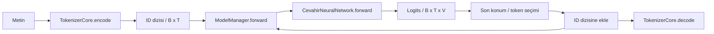

# 1. Motor, dil modeli ve öğrenme

[İçindekiler](../README.md) · [Sonraki: Metinden token kimliklerine](02-metin-tokenizer.md)

Bir mesajdan cevap üreten sistemi dışarıdan tek bir kutu gibi görürüz. İçeride ise farklı işler vardır: metni sayılara çevirmek, bu sayılar üzerinde öğrenilmiş hesap yapmak, sıradaki parçayı seçmek, konuşma geçmişini hazırlamak, gerekiyorsa bir araç çağırmak ve durumu saklamak. **Yapay zeka motoru**, bu kitapta bu işlerin uygulanabilir bir bütünde bağlandığı altyapıyı anlatır. Tek bir bilimsel model türünün adı değildir.

Cevahir'de bu ayrım somuttur. [Birleşik `Cevahir` sınıfı](../../../model/cevahir.py#L963) kullanıcıya metin, üretim ve bilişsel işlem girişleri açar. [`ModelManager`](../../../model_management/model_manager.py) modelin kurulumu, kullanımı ve saklanmasını yönetir. [`CevahirNeuralNetwork`](../../../src/neural_network.py#L85) sayısal hesabı yapar. [`TokenizerCore`](../../../tokenizer_management/core/tokenizer_core.py) metin ile token kimlikleri arasındaki dönüşümü üstlenir. Bu parçaların hiçbiri tek başına bütün motor değildir.

## Dil modeli hangi problemi çözer?

Bir dil modeli, bağlamdaki tokenlardan sonra hangi tokenların daha olası olduğunu hesaplayabilir. `x_1,…,x_T` bir token dizisiyse autoregressive modelin kullandığı çarpanlara ayırma:

$$
p_\theta(x_1,\ldots,x_T)=\prod_{t=1}^{T}p_\theta(x_t\mid x_1,\ldots,x_{t-1}).
$$

`θ`, modelin öğrenilebilir sayılarını, yani parametrelerini belirtir. Bu eşitlik bir sistemin doğru, tutarlı veya bilgili cevap vereceğinin garantisi değildir. Öğrenilen dağılım eğitim verisine, model kapasitesine ve eğitim yöntemine bağlıdır. Üretimde seçilen token en olası token olabilir veya olasılıklara göre örneklenebilir; bu seçim modelin kendisinden ayrı bir işlemdir.

Sadece son birkaç kelimenin sayımını kullanan n-gram modeli daha küçük ve daha kolay incelenebilir bir alternatiftir; fakat uzun bağlamı temsil etme biçimi sınırlıdır. Yinelenen ağlar geçmişi bir çalışma durumunda taşır. Transformer ise bir katmanda token temsillerini attention yoluyla ilişkilendirir. Cevahir'in etkin sinirsel yolu Transformer tabanlı, nedensel maske kullanabilen bir decoder'dır. Sınıf adında `TransformerEncoderLayer` geçmesi, mevcut çalışma yolunu otomatik olarak BERT tarzı çift yönlü bir encoder yapmaz. [Dördüncü](04-attention.md) ve [beşinci bölüm](05-transformer.md) maskeyi ve çağrıları açar.

## Sayılara dönüşün ilk resmi

Token, modelin işlediği metin parçasıdır; kelime olmak zorunda değildir. Token ID, bu parçanın sözlükteki tam sayı adresidir. Örneğin kavramsal `[12,7,31]` dizisi üç tokenı gösterir; bunlar Cevahir'in gerçek sözlüğüne aitmiş gibi varsayılmamalıdır. ID'nin büyüklüğü anlam büyüklüğü değildir. Model önce bu adreslerden öğrenilebilir vektörleri, yani embedding satırlarını seçer.

Bir batch `B` dizi, her dizi `T` token içeriyorsa kimlik tensörünün şekli `[B,T]`dir. Embedding ve katmanlar bunu `[B,T,D]` temsillere, çıkış projeksiyonu `[B,T,V]` logits tensörüne dönüştürür. `D` temsil genişliği, `V` sözlük büyüklüğüdür. Logit bir olasılık değildir: aynı konumdaki `V` sayı softmax ile normalize edilince toplamı 1 olan bir dağılım elde edilir.

$$
p_i=\frac{e^{z_i}}{\sum_{j=1}^{V}e^{z_j}}.
$$

Token seçimi bu dağılım üzerinde yapılır; seçilen ID mevcut diziye eklenir ve bir sonraki adımın bağlamına katılır. Sonunda tokenizer'ın decode yolu ID'leri metne çevirir. Decode, logits tensörünü doğrudan cümleye çeviren bir sinir ağı değildir.



Bu çizim veri akışıdır; her ok bağımsız bir HTTP çağrısı veya nesne oluşturma değildir. Gerçek üretim döngüsü [8. bölümde](08-uretim.md) incelenen `CevahirModelAPI` içindedir. `ModelManager.generate` adı tek başına tam autoregressive döngü anlamına gelmez; eski kısa yolu vardır. Metot adı yerine uygulamayı okumamızın nedeni budur.

## Cevahir'de tek ileri geçişi izlemek

[`Cevahir.forward`](../../../model/cevahir.py#L1291), metin/ID listesi/tensörü `_InputValidator.validate_and_convert_input` ile uygun tensöre çevirir, sonra yöneticiyi çağırır. Kaynaktaki küçük bağlantı:

```python
logits, _ = self._model_manager.forward(inputs, **kwargs)
```

[`ModelManager.forward`](../../../model_management/model_manager.py#L486) girdiyi aygıta taşır, maskeleri ve desteklenen seçenekleri düzenler, çekirdeği çağırır ve logits ile yardımcı çıktıyı döndürür. `inference=True` yolunda gradyan kaydı kapatılır ve değerlendirme modu geçici uygulanır. Facade yalnız logits döndürür. Aynı adla anılan katmanların dönüş tiplerini karıştırmamak gerekir.

| Sınır | Kim çağırır? | Ne alır, ne üretir? | Sonraki kullanım |
|---|---|---|---|
| `Cevahir.forward` | Facade kullanan uygulama | Metin/liste/tensör → logits | Doğrudan inceleme veya uygulamanın kendi hesabı. |
| `ModelManager.forward` | Facade, üretim adaptörü veya eğitim yolu | ID tensörü ve seçenekler → `(logits, aux)` | Kayıp hesabı, token seçimi veya tanılama. |
| `CevahirNeuralNetwork.forward` | Model yöneticisi veya doğrudan çekirdek kullanıcısı | ID'ler → katman hesabı ve vocabulary projeksiyonu | Yönetici/adaptör; cache dönüş sözleşmesi 5 ve 8. bölümlerde. |

Bu sınırların biri değişirse etkisi son metne kadar gider. Örneğin vocabulary boyutu değiştirilirken tokenizer ID anlamları korunmazsa, doğru boyutlu bir tensör yanlış tokenları ifade edebilir. Bir maskenin anlamını ters çevirmek geleceği gizlemek yerine erişimi yanlış yere açabilir. Mimari öğrenmek bu bağımlılıkları takip etmektir.

## Eğitilmemiş bir motoru çalıştırmak

Repository kökünden, PyTorch kurulu ortamda şu küçük örnek gerçek `ModelManager` ile ileri geçiş yapar:

```python
import torch
from model_management.config_schema import tiny_model_config
from model_management.model_manager import ModelManager

torch.manual_seed(42)
torch.set_num_threads(1)
manager = ModelManager(tiny_model_config())
manager.initialize(
    build_optimizer=False, build_criterion=False, build_scheduler=False
)
logits, attention = manager.forward(
    torch.tensor([[1, 5, 8, 2]]), inference=True
)
assert tuple(logits.shape) == (1, 4, 128)
assert torch.isfinite(logits).all()
```

[`tiny_model_config`](../../../model_management/config_schema.py#L660) iki katman, 32 genişlik ve 128 tokenlık sözlükle CPU boyutlu bir deneme kurar. Rastgele başlangıçlı model kullanılır. Bu örnek dil kalitesini, Türkçe yeteneği veya öğrenmeyi göstermez; veri/hesap sözleşmesini görünür kılar. Gerçek dil üretimi için eğitilmiş checkpoint ve onunla aynı tokenizer gerekir. Mevcut [başlangıç yönergeleri](../../../README-TR.md) ve [modül rehberleri](../../modules/README.md) kurulum ayrıntılarını taşır.

## Hesap yapmak ile öğrenmek

İleri geçişte aynı parametreler yeni girdiye uygulanır. Eğitimde ise bir hedefle karşılaştırılan çıktıdan kayıp üretilir; türevler ve optimizer aracılığıyla parametreler değiştirilir. Bu yüzden daha uzun cevap üretmek, tek başına daha fazla öğrenmek değildir. KV cache'i doldurmak da ağırlık güncellemesi değildir.

Kayıp `L(θ)` için basit gradyan adımı `θ' = θ − η∇_θL` biçimindedir. Cevahir'in etkin eğitim yolu daha fazla ayrıntı taşır: padding hedefleri, geçerli token sayıları, birikmiş gradyanlar, hassasiyet ölçekleme ve MoE yardımcı kaybı. Bunları tek denklemin arkasına gizlemek yerine [6. bölümde](06-egitim.md) gerçek döngüyle bağlarız.

Öğrenme araştırmamız parametre optimizasyonundan daha geniş bir soru soruyor: deneyim gelecekte yapılabilen hesapları kalıcı ve kontrollü biçimde değiştirebilir mi? Bu soru, metin geçmişini context'e eklemekten de farklı. Yeni bir yürütme kuralı edinme, mevcut kuralları daha ucuz yürütülebilir hale getirme ve sonraki deneyimden öğrenme biçimini değiştirme farklı deneylerde incelendi. Bunlar [11. bölümün](11-arastirma-laboratuvari.md) konusu; motorun zaten genel olarak yaşarken öğrendiği varsayımı değildir.

## Matematiği okumak için gereken küçük araç kutusu

Skaler tek sayıdır; vektör sıralı sayılar, matris iki eksenli sayılar tablosudur. Bu kitapta tensör, gerektiğinde daha çok ekseni olan sayısal diziyi anlatır. Eksenin **anlamı** boyutu kadar önemlidir: `[2,3,4]`, iki örnek, üç zaman konumu ve dört özellik olabilir. Aynı on iki sayıyı `[3,4]` ve `[4,3]` biçiminde düzenlemek aynı hesap değildir. `reshape` görünümü değiştirir; `transpose` eksenleri yer değiştirir; birinin gerektiği yerde öteki kullanılamaz.

Vektörlerin iç çarpımı `a·b=Σᵢaᵢbᵢ` olsun. `a=(1,2)` ve `b=(3,−1)` için sonuç `1`dir. Matris çarpımında her çıktı, bir satır ile bir sütunun iç çarpımıdır. `X:[T,D]` ve `W:[D,K]` ise `XW:[T,K]` olur. Örneğin `X=[[1,2],[0,1]]`, `W=[[2],[−1]]` seçildiğinde çıktı `[[0],[−1]]`dir. Attention ve vocabulary projeksiyonu bu temel işlemi farklı eksenlerde kullanır. Bunlar öğretim sayılarıdır; eğitilmiş Cevahir ağırlıkları değildir.

Batch ekseni, aynı hesabın birden çok örneğe uygulanmasını sağlar. Batch'teki iki konuşma aynı attention bağlamına otomatik olarak birleşmez. `[B,T,D]` üzerinde son boyuta uygulanan `Linear(D,K)`, her örnek ve konum için aynı ağırlıkları kullanır. Ağırlık paylaşımı hesabın bütün konumlarda ortak olmasını sağlar; konumlar arası bilgi taşıma ise attention gibi başka bir işlemin görevidir. PyTorch `Linear` ağırlığı `[K,D]` saklar; matematikteki satır-vektör gösterimiyle uygulama `XWᵀ+b` olarak okunur. [3. bölüm](03-sinir-aglari.md) bu saklama/çarpma ayrımını gerçek katmana bağlar.

Bir türev, çok küçük giriş değişimine çıktının yerel duyarlılığıdır. `f(w)=w²` için `f′(w)=2w`; `w=3` yakınında `Δw=.01` değişiminin birinci dereceden tahmini `.06`dır. Gerçek değişim `.0601`dir; doğrusal yaklaşımın kalan terimi vardır. Gradyan, çok parametreli kaybın her parametreye göre bu türevlerini toplar. Negatif gradyan yönü yeterince küçük adımda yerel düşüş sağlar; herhangi bir öğrenme oranında, yeni veride veya bütün yaşam boyunca iyileşme garantisi vermez. Zincir kuralı, bileşik hesabın duyarlılığını ardışık yerel türevlerden hesaplar; ağ eğitiminin matematiksel bağlantısı budur.

## Olasılık hesabından eğitim hedefine

`p(a,b)=p(a)p(b|a)` eşitliği koşullu olasılık tanımından gelir; bağımsızlık varsayımı değildir. Üç token için `p(a)=.5`, `p(b|a)=.2`, `p(c|a,b)=.8` seçersek dizinin olasılığı `.08` olur. Uzun dizilerde çok küçük sayıların çarpımı yerine logaritmalar toplanır. Böylece negatif log-olabilirlik `−log(.08)≈2.525729`, token başına ortalama ise `≈.841910` olur. Burada doğal logaritma kullanıyoruz. Olasılık zincir kuralının genel çerçevesi için [Goodfellow, Bengio ve Courville'in kendi açık ders kitabı](https://www.deeplearningbook.org/contents/prob.html) başvuru kaynağıdır.

Dil modeli eğitiminde gözlenen sonraki tokenın olasılığını yükseltmek için bu negatif logaritma azaltılır. Hedef `y` bir token kimliği olduğunda tek konum kaybı `−log pθ(y|bağlam)`dır. Bir eğitim örneğinin doğru yanıtını ezberleyen model bu kaybı düşürebilir; yeni örneklerde iyi sonuç ayrı bir ölçümdür. Modelin doğal dilden yararlı ilişkiler edinmesini beklememiz, her parametrede anlaşılır bir bilgi kaydı bulunduğu anlamına gelmez. Dağıtılmış temsilin anlamı tek bir ağırlıktan güvenilir biçimde okunamaz.

Softmax'ın sayısal uygulamasında bütün logitlerden en büyüğü çıkarılabilir:

$$
\frac{e^{z_i-c}}{\sum_j e^{z_j-c}}=\frac{e^{z_i}}{\sum_j e^{z_j}},\qquad c=\max_j z_j.
$$

Bu eşitlik dağılımı değiştirmeden büyük pozitif üstelleri önler. Örneğin `(1000,1000)` için matematiksel dağılım `(.5,.5)`dir; doğrudan üstel almak sonlu duyarlıkta taşabilir. Bu nedenle sayısal doğru uygulama, kâğıt üzerindeki doğru denklemden ayrı incelenir. Eğitim bölümündeki `log_softmax`/cross-entropy bağlantısı bu ihtiyaca dayanır.

## Genelleme nasıl sınanır?

Eğitim verisi parametreleri, doğrulama verisi yöntem ve ayar seçimini, ayrılmış test verisi ise seçilmiş yöntemin değerlendirmesini destekler. Aynı örnekleri bütün adlarda kullanmak üç bağımsız kanıt üretmez. Bir dokümanın neredeyse aynı parçaları iki bölüme dağılırsa dosyalar farklı olsa bile sızıntı olabilir. [6. bölümdeki](06-egitim.md) gerçek veri bölme yolu bunun uygulama tarafını gösterir. Sürekli öğrenmede zaman sırası ayrıca önemlidir: bir olayın cevabını gördükten sonra o olay üzerindeki başarı, cevabı görmeden önceki başarı olarak kaydedilmez.

Genelleme her zaman bir kullanım alanına göredir. Eğitimden ayrı Türkçe bir metin, yeni bir programlama dili ve değişmiş fiziksel çevre aynı dağılım değildir. Bu nedenle sonuçta hangi örneklerin yeni olduğu yazılmalıdır. Düşük ortalama hata, nadir ama önemli bir altkümede düşük hata anlamına da gelmez. Dil modelinin olasılığının yüksek olması, bir önermenin dünyada doğru olduğunun doğrulanmış olasılığı değildir; dağılım entropisi ile olgusal güven ayrımı [8. bölümde](08-uretim.md) tekrar kullanılır.

## Kod okurken üç farklı sözleşme

İlk sözleşme **şekil ve türdür**: ID'ler tamsayıdır; logits kayan noktalı puanlardır. İkincisi **anlamdır**: ID `17` hangi tokenizer'da hangi parçayı belirtir? Üçüncüsü **yaşam döngüsüdür**: durum kime aittir, ne zaman sıfırlanır, kaydedilince ne taşınır? İlk sözleşmenin geçmesi diğer ikisini kanıtlamaz.

Bu ayrım giriş doğrulamada bile görülür. [`_InputValidator.validate_and_convert_input`](../../../model/cevahir.py#L280), tensor türünü `long`a çevirir, bazı eksikleri tamamlar ve en büyük ID sözlüğü aşarsa clamp uygular. Bu dal yanlış tokenizer kimliğini onarmaz; çok büyük bir adresi son geçerli adrese değiştirmek bilgi kaybıdır. Yalnız negatif ID içeren bir girdi de en büyük ID kontrolünü tetiklemeyebilir. Dolayısıyla bu yordamı bütün geçersiz girdileri reddeden katı bir doğrulayıcı diye anlatmıyoruz. Kitabın çalıştırılabilir örnekleri geçerli ID aralığını açıkça kurar.

Bir dosyanın “endüstri standardı” yorumu tek başına standart belgesi değildir. Kitap, Transformer için [Vaswani ve arkadaşlarının özgün çalışmasına](https://arxiv.org/abs/1706.03762), uygulama için gerçek çağrıya, ölçüm için çalıştırılmış kayda başvurur. Özgün Transformer makalesinin encoder–decoder düzeni ile Cevahir'in etkin nedensel yolu aynı mimari ilan edilmez. Sonraki bölümlerdeki endüstri örnekleri de belirli tarihli modellerin yöntemlerini açıklar; bütün güncel ürünlerin içeride aynı hesabı yaptığı iddiası taşımaz.

## Çözümlü alıştırmalar

### 1. Şekli ve belleği hesaplayın

`B=2,T=5,D=8,V=32` için ID, embedding ve logits şekilleri nedir? **Çözüm:** `[2,5]`, `[2,5,8]`, `[2,5,32]`. Logits 320 sayı içerir; FP32 ham veri alanı 1.280 bayttır. Ara aktivasyonlar, parametreler ve nesne yükleri bu sayıya dahil değildir.

### 2. Logit kaydırma

`z=(0,log 3)` ve `z′=z+100` aynı dağılımı verir mi? **Çözüm:** Evet; ortak `e¹⁰⁰` sadeleşir. İkisinin dağılımı `(.25,.75)`tir. İkinci token doğruysa kayıp `−log(.75)≈.287682` olur.

### 3. Zincir kuralı bağımsızlık mı ister?

`p(a)=.4`, `p(b|a)=.5` ise `p(a,b)` nedir? `p(b)` de `.5` olmak zorunda mı? **Çözüm:** Ortak olasılık `.2`dir. `p(b)` diğer ilk-token koşullarına da bağlıdır; bağımsızlık verilmeden bu sonuç çıkmaz.

### 4. Değişen durum öğrenme midir?

Ağırlıkları sabit modelin KV cache'i büyüyor, ikinci yanıt değişiyor. Kalıcı edinim gösterilmiş midir? **Çözüm:** Hayır. Bağlamın değişmesi açıklama olabilir. Cache temizlendikten ve yeni görevler verildikten sonra deneyimle edinilen kalıcı durumun etkisi ayrıca karşılaştırılmalıdır.

### 5. Sızıntıyı belirleyin

Bir belgenin ilk sürümü eğitimde, yalnız başlığı değiştirilmiş sürümü testte. Dosyalar farklı olduğuna göre bağımsız test elde edildi mi? **Çözüm:** Hayır. İçerik tekrarları başarıyı şişirebilir. Ayrım birimi ve yakın kopya kontrolü, amaçlanan genelleme türüne göre seçilmelidir.

## Kaynakça

1. Goodfellow, I., Bengio, Y. ve Courville, A. (2016). *Deep Learning*, MIT Press; [yazarların açık çevrim içi baskısı](https://www.deeplearningbook.org/). Temel matematik ve olasılık için başvuru kitabı; Cevahir uygulaması hakkında kanıt değildir.
2. Vaswani, A. ve diğerleri (2017). [Attention Is All You Need](https://arxiv.org/abs/1706.03762), NeurIPS. Attention ve Transformer'ın özgün mimari kaynağı; Cevahir'e özgü tercihler 4–5. bölümlerde ayrılır.

## Kendi kontrol sorunuz

Yukarıdaki örnekte logits şekli doğru fakat üretilen metin anlamsızsa, hangi iddia doğrulanmış olur? Yalnız ileri geçiş ve boyut sözleşmesi. Aynı örneğe tokenizer eklemek bu ağırlıkları eğitmez. Tokenizer, veri temsili ile öğrenilmiş parametrelerin arasındaki anlam sözleşmesini kurar; şimdi bu sözleşmeyi açacağız.

[İçindekiler](../README.md) · [Sonraki bölüm](02-metin-tokenizer.md)
