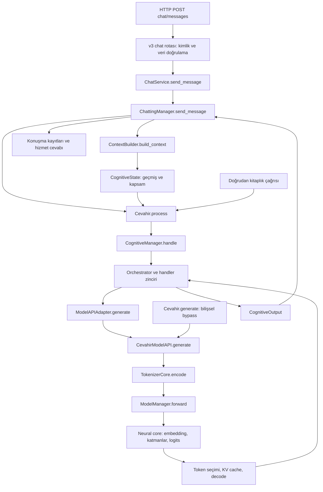

# 10 · Bir mesajın sistem boyunca yolculuğu

[İçindekiler](../README.md) · [Önceki: Bellek, biliş ve araçlar](09-bellek-bilis-araclar.md) · [Sonraki: Araştırma laboratuvarı](11-arastirma-laboratuvari.md)

Artık metnin sayılara nasıl dönüştüğünü, ağın nasıl eğitildiğini ve tokenların nasıl üretildiğini biliyoruz. Bir sistem bu mekanizmaların yan yana dizilmesinden fazlasıdır: **hangi bileşenin hangi durumu sahiplendiği** ve **bir çıktının sonraki bileşen için ne anlama geldiği** açık olmalıdır. Yoksa doğru bir attention hesabı bile yanlış tokenizer kimliği, yanlış oturum geçmişi veya paylaşılan cache nedeniyle yanlış kullanılır.

Bu bölüm üç gerçek giriş yolunu ayırır. Cevahir kitaplık arayüzü, sohbet/veritabanı yöneticisi ve HTTP hizmeti birbirini her durumda aynı sırayla çağırmaz. Diyagram bir tasarım temennisi değil, kaynakta bulunan bağlantıların haritasıdır.

## Kurulum ile istek işleme farklı evrelerdir

[Cevahir.__init__](../../../model/cevahir.py#L1006), tokenizer, ModelManager, model adaptörü ve isteğe göre cognitive manager bağlantılarını kurar. Dışarıdan hazırlanmış bileşenler de verilebilir. [_init_model](../../../model/cevahir.py#L1142), model ayarlarını ve yükleme tercihini ele alır; [_init_cognitive](../../../model/cevahir.py#L1191), `CevahirModelAPI` üzerinden model erişimi sağlayan bilişsel yöneticiyi oluşturur. Kurulumda mimari boyut seçmek veya checkpoint yüklemek, her kullanıcı mesajında tekrar yapılacak işlem değildir.

HTTP tarafında [api.app_factory.create_app](../../../api/app_factory.py#L191), Cevahir ve ChattingManager örneklerini kurar veya dışarıdan alır; ardından servisleri ve rotaları bağlar. `create_cevahir_instance` içindeki model ayarları ortak `normalize_model_config` yolundan geçer. `CEVAHIR_MODEL_PROFILE="legacy_api"`, eski API boyutlarını açık uyumluluk tercihi olarak seçer; her arayüz için farklı gizli bir varsayılan mimari sayılmamalıdır. Ortam, tokenizer dosyaları ve checkpoint seçimi yine kurulumun parçalarıdır.



Diyagramdaki geri ok, aynı çağrının sonucunun dönmesini gösterir. Özellikle `Cevahir → ChattingManager` zorunlu bir çağrı yoktur: **ChattingManager, sahip olduğu Cevahir örneğini çağırır.** Doğrudan Cevahir kullanımı, SQL konuşma kaydını kendiliğinden oluşturmaz.

## Örnek mesaj: girişten bağlama

Kullanıcı mevcut oturumuna “Önceki hesaplamayı 12 ile yeniden yap” gönderdiğini düşünelim. [v3 chat rotası](../../../api/routes/v3/chat.py#L33) doğrulanmış kullanıcı kimliğini kullanır; JSON'dan `session_id` ve `message` alır. [ChatService.send_message](../../../api/services/chat_service.py#L39), bunları değiştirmeden [ChattingManager.send_message](../../../chatting_management/chatting_manager.py#L111) metoduna iletir. Servis katmanı modelin token seçimini uygulamaz; iletişim sözleşmesini ve hataların taşınmasını düzenler.

ChattingManager önce oturum erişimini ve mesaj uzunluğunu doğrular. Sonra [ContextBuilder.build_context](../../../chatting_management/components/context_builder.py#L79) geçmişi kurar. `_get_recent_history`, yapılandırılmış sayıda yakın mesaj alır, en yeni sonek bütçeye sığana kadar seçer ve kronolojik sıraya döndürür. Burada token sayısı gerçek tokenizer çalıştırılarak ölçülmez; toplam karakter sayısının dörde bölünmesiyle yaklaşık hesaplanır. Dolayısıyla `max_context_tokens`, bu seviyede kesin token sınırı değildir. Bunun değiştirilmesi eski mesajların görünürlüğünü ve son prompt uzunluğunu değiştirir.

Mevcut mesaj bu geçmişe hemen eklenmez; bilişsel promptta zaten ayrı kullanıcı girdisi olarak bulunacaktır. Üretimden sonra geçmişe eklenmesi, aynı mesajın promptta iki kez yer almasını önler. Kullanıcı belleği etkinse `_get_memory_context` yüksek öncelikli kayıtları alır. Metodun `query` parametresi vardır ama bu SQL seçiminde sorgu embedding'i hesaplanmaz; bunu önceki bölümün vektör retrieval'ıyla karıştırmamak gerekir.

## Bağlamdan model çağrısına

[Cevahir.process](../../../model/cevahir.py#L1621) boş bırakılan state yerine yeni `CognitiveState` kurar; `text` ve ek alanlardan `CognitiveInput` oluşturur ve manager'a iletir. Kaynaktaki esas bağlantı küçüktür:

```python
if state is None:
    state = CognitiveState()

input_msg = CognitiveInput(user_message=text, **kwargs)
output = self._cognitive_manager.handle(state, input_msg)
```

Bu çağrıda state'i yeniden kullanmak geçmişi sürdürür; her tur yeni state vermek farklı bir yaşam döngüsüdür. `kwargs`, CognitiveInput alanları olmalıdır; rastgele bir model ayarının burada otomatik kabul edildiği varsayılmamalıdır. Açık üretim ayarları için `Cevahir.generate` ve `DecodingConfig` yolu ayrıca vardır.

Orchestrator, [önceki bölümdeki](09-bellek-bilis-araclar.md) strateji ve bağlam zincirini çalıştırır. Hesap makinesi gerçekten seçilip yürütülürse sonuç prompta girer. Model çağrısı şu sınırları geçer:

| Çağıran → alıcı | Girdi | Çıktı ve sonraki kullanım |
|---|---|---|
| `GenerationHandler` → `ModelAPIAdapter.generate` | Context metni, decoding ayarları | Backend farklarını gizleyen metin üretim çağrısı. |
| Adaptör → `CevahirModelAPI.generate` | Prompt, `DecodingConfig` | Kilitlenen, tokenizer ve autoregressive döngüyü yöneten çağrı. |
| `TokenizerCore.encode` → üretim yordamı | Prompt metni | Token listesi ve kimlikler; kimliklerden `[1,T]` tensörü kurulur. |
| Üretim yordamı → `ModelManager.forward` | Token tensörü, cache konumu, inference bayrağı | Çekirdek logits'i; son konum seçime gider. |
| Çekirdek → üretim yordamı | Embedding ve Transformer hesabı | Vocabulary boyutunda puanlar; seçilen token yeni girdiye döner. |
| `TokenizerCore.decode` → bilişsel akış | Yalnız üretilmiş kimlikler | Taslak metin; gerekirse seçim/critic aşamalarına gider. |

`inference=True`, ModelManager içinde gradyan kaydını kapatır ve ileri geçişi evaluation davranışında çalıştırır. Bu, eğitimdeki loss–backward–optimizer yolunu çağırmaz. Çekirdek hesabı ile token seçimi ayrı olduğu için kötü cevapta hangi katmanın inceleneceği ayrıca belirlenmelidir: yanlış bağlam, araç sonucu, logits veya decoding ayarı farklı nedenlerdir.

## Dönüş yolu ve kayıt sahipliği

Pipeline sonunda [build_output](../../../cognitive_management/v2/processing/pipeline.py#L261), `CognitiveOutput` üretir: son metin, kullanılan mod, başarılı araç adı, critic bilgileri, retrieval kaynakları ve işlem metaverileri. ChattingManager buradan `output.text` alır; kullanıcı ve asistan mesajlarını konuşma deposuna ekler, oturum etkinliğini günceller, cevap sözlüğünü servise döndürür. Bilişsel bellek güncellemesi ile veritabanındaki mesaj kaydı farklı sahiplerde gerçekleşir.

Bu ayrım hata sınırlarını da belirler. Kod sırasına göre cevap üretildikten sonra kayıt yapılır. Dolayısıyla SQL kayıt hatası, modelin hiç çalışmadığını göstermeyebilir. Aynı isteğin tekrar gönderilmesi için uçtan uca idempotent işlem garantisi bu çağrı sırasından çıkarılamaz. Bir model cevabının hesaplanması, geçmişe alınması ve HTTP istemcisine teslim edilmesi üç ayrı olaydır.

## İşlem sınırı, tekrar gönderme ve kısmi başarı

Veritabanı transaction'ı, kapsadığı değişiklikleri birlikte kabul etmek veya hata halinde geri almak için bir sınır tanımlar. Bütün uygulamayı kendiliğinden bu sınıra almaz. [`ConversationStorage.add_message`](../../../chatting_management/storage/conversation_storage.py#L55), her mesaj ekleyişinde ayrı bir [`UnitOfWork`](../../../database/unit_of_work.py#L28) açar. `UnitOfWork.__exit__`, başarılı çıkışta commit, hata halinde rollback yapar. Dolayısıyla kullanıcı mesajı ve asistan mesajı **iki farklı transaction** içindedir. Bu kaynak okuması [SQLAlchemy'nin session/transaction açıklamasıyla](https://docs.sqlalchemy.org/en/20/orm/session_basics.html) uyumludur; SQLAlchemy kullanmak bütün HTTP isteğini atomik yapmaz.

Çağrı sırasını durum geçişleriyle yazabiliriz: `S₀ → üretim tamamlandı → kullanıcı satırı commit → asistan satırı commit → yanıt teslimi`. Kullanıcı satırından sonra ikinci kayıt hata verirse `S₀`a dönülmüş değildir. Aşağıdaki örnekte hata ikinci eklemeye girmeden enjekte edilir; ilk satır kalır. Elektrik kesintisi, dosya sistemi dayanıklılığı veya dağıtık transaction deneyi yapılmaz. [SQLite transaction belgesi](https://www.sqlite.org/lang_transaction.html), kullanılan yerel depolamanın işlem davranışı için kaynaktır; kitap örneğinin kanıtı ayrıca kayıtlıdır.

| Olay | Model/backend çağrısı | SQL konuşma sonucu | İstemci açısından |
|---|---:|---|---|
| Geçerli başarılı istek | 1 | Kullanıcı ve asistan satırı | Normal yanıt |
| Başka kullanıcının oturumu | 0 | Değişiklik yok | Erişim hatası |
| Üretim sırasında hata | 1 girişim | Bu isteğin mesajları eklenmez | Entegrasyon hatası |
| İkinci mesajı kaydetmeden hata | 1 tamamlanmış çağrı | Yalnız kullanıcı satırı | Normal dönüş yok |
| Aynı içerik yeniden gönderilir | Yeni çağrı | Yeni satır çifti | İkinci istek olarak işlenir |

**Idempotence**, aynı isteğin tekrarlanmasının amaçlanan etkisinin bir kez uygulanmasıyla aynı olmasıdır; aynı metni üretmekle özdeş değildir. [RFC 9110, §9.2.2](https://www.rfc-editor.org/rfc/rfc9110.html#section-9.2.2), HTTP yöntemlerinin bu semantiğini tanımlar. POST mesaj yolunda böyle bir uygulama garantisi ayrıca kurulmalıdır. Burada `request_id` temelli kalıcı tekilleştirme gösterilmediği için tekrar gönderme yeni üretim ve yeni kayıt oluşturabilir. Bir yanıt cache'i de tek başına idempotent SQL yazımı sağlamaz.

Bu sınırı iyileştirmek için işlem kimliğiyle sonuç eşlemek veya mesaj çiftini birlikte kaydetmek düşünülebilir; bunlar **tasarım seçenekleridir**, bu kitap turunda uygulanmış özellikler değildir. İki satırın tek transaction'a alınması bile dış aracın yan etkisini ve ağda kaybolan teslim bilgisini kendiliğinden çözmez. Tasarım hedefi açıkça “iki mesajın birlikte kaydı” veya “aynı işlem kimliğine tek sonuç” gibi test edilebilir olmalıdır.

## Bağlam bütçesi gerçek prompt bütçesi değildir

`ContextBuilder._estimate_tokens`, içerik karakterlerini sayıp dörde böler ve aşağı yuvarlar. Türkçe için bütün metinlerde geçerli bir tokenizasyon eşitliği değildir. Örnekte kronolojik mesajlar `old old old!`, `abcdefgh`, `ijklmnop` olsun. Son iki mesaj sekizer karakterdir ve her biri iki tahmini token sayılır. Bütçe dört olduğunda en yeni iki mesaj seçilir, sonra kronolojik sırada döndürülür. Mevcut kullanıcı girdisi bu listedeki dördüncü mesaj olarak eklenmez; başka alandan prompta girer.

Seçici `break` kullandığı için en yeni mesaj tek başına bütçeyi aşıyorsa daha eski kısa mesajları aramaz. Bütçe dört, en yeni içerik yirmi karakter olduğunda yakın geçmiş boş kalır. Bu davranış “bütçeye sığan bütün parçaları seç” optimizasyonu değil, “bütçeye sığan en yeni kesintisiz sonek” kuralıdır.

Üstelik yüksek öncelikli kullanıcı belleği, geçmiş seçildikten sonra `system_summary` olarak öne eklenir. Son prompta sistem talimatları ve mevcut girdi de katılabilir. Bu nedenle yaklaşık geçmiş bütçesi, son metnin token sayısına üst sınır vermez. Aşağıdaki yürütmede bütçe `1` iken tek bellek satırı bile bu tahmini aşar. Modelin gerçek bağlam sınırına uyum, tokenizer ve üretim katmanındaki kesme davranışlarıyla ayrıca incelenmelidir. Bütçelerin hangi noktada uygulandığını bilmeden “maksimum dört token” demek yanlış sözleşme kurar.

## İstek kimliği bir metin parçası değildir

[`request_scope._prepare`](../../../cognitive_management/v2/utils/request_scope.py#L26), kapsamı `state.metadata['user_id']` ile `state.session_id` üzerinden oluşturur. Kullanıcı mesajının içinde “başka kullanıcıyım” yazması bu alanları değiştirmez. Doğrudan kitaplık çağıran kod state'i kendisi sağladığından o sınırda kimlik oluşturma sorumluluğu uygulamadadır; HTTP kimlik denetimi doğrudan çağrıya otomatik taşınmaz.

[`memory_scope`](../../../cognitive_management/v2/utils/request_scope.py#L18), önceki `ContextVar` değerini `finally` içinde geri yükler. Bu yüzden çağrı hata verse de kapsamın önceki bağlama dönmesi beklenir. Python'ın [contextvars belgesi](https://docs.python.org/3.14/library/contextvars.html), bağlama yerel değer ve reset işleminin arayüz kaynağıdır. ContextVar bir yetkilendirme sistemi veya veritabanı satır filtresi değildir; kapsamı kullanan her alt bileşenin bunu doğru uygulaması gerekir. Kitap örneği kapsam değerini çağrı içinde kontrol eder ve hem başarıdan hem hatadan sonra `local`a dönüşü sınar.

## Yedi çalıştırılmış sistem örneği

[`book_system_walkthrough.py`](../../../scripts/book_system_walkthrough.py), gerçek ChattingManager, ContextBuilder, conversation storage, UnitOfWork ve istek kapsamını geçici SQLite üzerinde çalıştırır. Model yerinde verilen sabit yanıtlı `ControlledBackend` öğretim fixture'ıdır. Bu ayrım testin amacıyla uyumludur: burada sinir ağının kalitesini değil, çevresindeki sahiplik ve hata sınırlarını ölçüyoruz. Test veritabanı kapanışta silinir; kullanıcının konuşma deposu kullanılmaz.

```powershell
python scripts/book_system_walkthrough.py
```

[Yürütme kaydındaki](../evidence/system_walkthrough.json) yedi grup şunlardır: başarılı çağrıda geçmişin/kaydın sırası; aynı isteğin iki kez gönderilmesi; oturum sahipliği; backend hatası; ikinci yazım hatası; yakın geçmiş bütçesi; bütçe sonrasında eklenen bellek. İlk çağrıda üretim anında sıfır kalıcı mesaj görülür, dönüşte iki satır vardır. Aynı içerikle ikinci çağrı sonunda dört satır oluşur. Yanlış kullanıcı backend'e ulaşamaz. İkinci kayıt hata verdiğinde yalnız kullanıcı satırı kalır. Bu sonuçlar mevcut davranışı görünür kılar; yüksek yük, HTTP taşıma veya donanım çökmesi doğrulaması değildir.

## Bir checkpoint hangi hayatı taşır?

Checkpoint modelin ağırlıklarını ve biçime göre optimizer/scheduler ile metadata'yı taşır. [ModelManager.save](../../../model_management/model_manager.py#L657) ve [load](../../../model_management/model_manager.py#L694), tokenizer kimliği ve model şekil sözleşmelerine bağlanır. Parametre matrisinin şeklinin uyumlu olması tek başına yeterli değildir: aynı token numarasının farklı anlama geldiği tokenizer ile yüklemek aynı modeli çalıştırmak değildir.

Konuşma veritabanı, request cache, KV cache, vektör store ve deneysel experience snapshot'ı otomatik olarak tek model checkpoint'inin içinde değildir. “Sistemi kaydettim” ifadesinin kapsamı bu yüzden belirtilmelidir. Yeniden açılan sistemin aynı cevabı veya aynı sonraki öğrenmeyi üretmesi, hangi durumların taşındığına bağlıdır. [Yaşam döngüsü uzlaştırma kaydı](../../architecture/LIFECYCLE_CONSOLIDATION.md), bu sahipliklerin ve tokenizer kimliğinin mühendislik geçmişini korur; [model yaşam döngüsü bölümü](07-model-yasam-dongusu.md) kayıt/yükleme ayrıntılarını açar.

## Eşzamanlılık ve okurun denetim rotası

Tek adaptörde üretim kilidi vardır; async handler'lar thread üzerinden aynı mantığı çalıştırır. Bunlar eşzamanlı eğitim/yükleme, bir modele bağlı birden fazla adaptör veya bütün depolar için atomik işlem garantisi değildir. İstek cache anahtarları da yalnız mesaj metninden ibaret olamaz: geçmiş, kullanıcı/oturum kimliği, decoding ve bellek revizyonu cevabı değiştirebilir. [request_scope](../../../cognitive_management/v2/utils/request_scope.py) bu bağlamı oluşturur; [agent sözleşmesi testleri](../../../tests/evolution/test_agent_contracts.py) geçmiş ve kimlik ayrımlarını kontrol eder.

[API sözleşmesi testleri](../../../tests/evolution/test_api_contracts.py), farklı uygulama factory'lerinin rota bağımsızlığını ve gerçek SQLite oturum sahipliğini sınar. [Runtime yaşam döngüsü testleri](../../../tests/evolution/test_runtime_lifecycle.py) checkpoint biçimlerini ve cache hit sonrasında geçmiş güncellemelerini ele alır. Bunların varlığı bütün dağıtım koşullarında ölçülmüş hizmet güvenilirliği değildir; okuyucu her testin fixture ve iddiasını incelemelidir.

Kaynak okuma alıştırması olarak bir mesajı yukarıdaki tabloda yürütün; her sınırda metin, kimlik listesi, tensör veya durum nesnesinden hangisinin taşındığını yazın. Sonra aynı mesajı `Cevahir.generate(..., use_cognitive_pipeline=False)` ile düşünün: geçmiş oluşturma, araç, retrieval ve critic yolları atlanır. Bu kontrollü fark, ağırlıklar değişmeden neden farklı davranış elde edildiğini açıklar. Sıradaki araştırma bölümü daha zor soruyu sorar: bu yaşantıların gelecekteki hesaplama kapasitesinde kalıcı, kontrollü ve genellenebilir değişiklik üretmesi hangi ek koşulları gerektirir?

## Çözümlü alıştırmalar

### 1. Çağıran kim?

`Cevahir.process` çağrısının mutlaka SQL geçmişi oluşturduğunu söyleyen çizim doğru mu? **Çözüm:** Hayır. SQL sohbet yolunda ChattingManager, Cevahir'i çağırır ve sonucu kaydeder. Cevahir'in doğrudan kullanımı bu yöneticiyi zorunlu olarak çağırmaz.

### 2. Yarım yazım

Yanıt üretildi, kullanıcı satırı kaydedildi, asistan satırından önce hata oldu. Rollback kullanıcı satırını siler mi? **Çözüm:** Mevcut yolda hayır; ilk `add_message` kendi transaction'ını commit etmiştir. Sonraki transaction'ın rollback'i önceki commit'i geri almaz.

### 3. Aynı metin ve idempotence

Sabit backend iki çağrıda aynı yanıtı veriyor. İstek idempotent midir? **Çözüm:** Bu bilgi yetmez. Çalıştırılmış örnekte iki çağrı dört satır üretir; depolama etkisi bir çağrının iki satırıyla aynı değildir.

### 4. Bütçe hesabı

Sekizer karakterlik üç mesaj ve dört birimlik yaklaşık geçmiş bütçesi var. Hangileri seçilir? En yeni mesaj yirmi karakter yapılırsa ne olur? **Çözüm:** İlk durumda en yeni iki mesaj kronolojik sırayla alınır. İkinci durumda en yeni mesajın tahmini beş olduğu için seçim orada durur ve yakın geçmiş boş kalır. Sonradan eklenen kullanıcı belleği bu hesaba dahil değildir.

### 5. Kontrol edilen ve edilmeyen

Geçici SQLite ve sabit backend ile bu yedi örneğin geçmesi eğitilmiş modelin güvenilirliğini kanıtlar mı? **Çözüm:** Hayır. Gerçek çevreleyen bileşenlerin belirtilen giriş ve hata noktalarındaki davranışını destekler. Gerçek tokenizer, neural forward, HTTP taşıma ve eşzamanlı yük burada çalıştırılmamıştır; bunlar ilgili bölümlerin ayrı ölçümleridir.

## Kaynakça

1. Fielding, R., Nottingham, M. ve Reschke, J., ed. (2022). [RFC 9110: HTTP Semantics](https://www.rfc-editor.org/rfc/rfc9110.html), özellikle §9.2.2. İstek semantiği ve idempotence tanımı.
2. SQLAlchemy geliştiricileri. [Session Basics, 2.0 belgeleri](https://docs.sqlalchemy.org/en/20/orm/session_basics.html). Session, commit ve rollback sınırları; erişim 21 Eylül 2026.
3. SQLite geliştiricileri. [Transaction](https://www.sqlite.org/lang_transaction.html). Yerel veritabanının işlem modeli; erişim 21 Eylül 2026.
4. Python Software Foundation. [contextvars, Python 3.14 belgeleri](https://docs.python.org/3.14/library/contextvars.html). Bağlama yerel değerlerin kurulması ve eski değere dönüş; erişim 21 Eylül 2026.

[İçindekiler](../README.md) · [Sonraki: Araştırma laboratuvarı](11-arastirma-laboratuvari.md)
