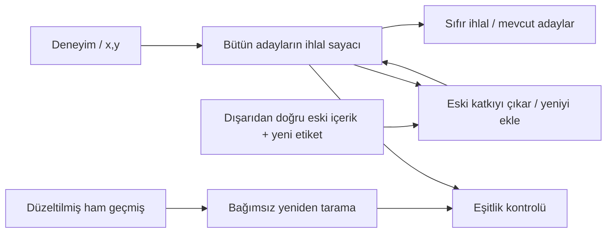

# 12. Bilmediklerimiz ve araştırmanın devamı

[İçindekiler](../README.md) · [Önceki: Araştırma laboratuvarı](11-arastirma-laboratuvari.md) · [Katkı ve bakım](../BAKIM.md)

Bu kitabın sonunda “Cevahir yaşarken öğrenmenin genel ilkesini buldu” sonucuna varamayız. Çalışan dil modeli motoru, deneyimle seçimi değişen opsiyonel politika ve bağımsız küçük öğrenme düzenekleri vardır. **Genel living-learning problemi çözülmedi.** Araştırmanın değeri, olumlu bulgular kadar nelerin birbirine eşit olmadığını somutlaştırmasındadır.

## Önceki sonuçlardan hangileri taşınabilir?

Parametre, sembolik kural, bellek, geçiş grafiği veya güncelleme matrisi farklı mekanizmalardır. Ortak bir işlevsel çerçeve yazabiliriz:

$$
a_t=C(s_t,o_t,b_t),\qquad e_t=(o_t,a_t,\text{erişilen sonuç}),\qquad
s_{t+1}=U(s_t,e_t).
$$

`o_t` gözlem, `a_t` cevap/eylem, `b_t` hesap bütçesi, `s_t` geleceğe taşınan durumdur. Bu denklem bir mimari icat etmez: herhangi bir durumlu sistemi bu biçimde yazmak mümkündür. Öğrenme iddiası için deneyimin oluşturduğu durum farkının **yeni koşullardaki yeteneği nasıl değiştirdiğini** ölçmeliyiz. Değişim tek başına yarar değildir; iyi görünen bugünkü cevap da gelecekte öğrenmenin korunmasını göstermez.

| Sonuç | Genel araştırmada rolü | Aşılmaması gereken sınır |
|---|---|---|
| Durumu silme/taşıma davranışı değiştiriyor | Deneyimin kalıcı nedensel etkisini sınama yolu | Aktarılan davranışın yararlı veya genellenebilir olduğu ayrıca ölçülür. |
| Aynı bilgi farklı bütçede farklı erişilebilirlik veriyor | Öğrenme ile derleme/konsolidasyon maliyetlerini ayırma | Affine bileştirme bütün hesap ailelerinin derleyicisi değildir. |
| Bugünkü yeterli durum yarınki güncellemeye yetmeyebilir | Öğrenme durumunu yalnız tahminle değerlendirmeme | Her görevde ham arşivin zorunlu olduğu sonucu çıkmaz. |
| Eski geçerli bilgi ile eskimiş bilgi ayrılmalı | Koruma ve düzeltmenin birlikte değerlendirilmesi | Replay veya unutma her dünyada iyi değildir. |
| Gözlemler bazı dünyaları ayıramaz | İddiaların bilgi erişimi sınırını belirtme | İmkânsız evrensel garanti göstermek gerçek araştırma görevini bitirmez. |
| İç değişken aynı dış girdide davranışı değiştirebilir | Yeni deneyim üreten hesabı ölçmeye alan açma | Rastgelelik, sapma veya biyolojik benzetme tek başına öğrenme ilkesi değildir. |

## Yeni tur: doğru bugünkü cevap, düzeltilebilir bilgi mi?

Önceki otomata deneyinde çalışma grafiği küçük kaldı; yeniden öğrenmek için arşiv korundu. Yeni [düzeltme durumu deneyi](../../research/living_learning_correction_2026_09_20/REPORT_TR.md), bu farkı bütün durumları sayılabilen küçük bir dünyada açtı.

Üç girdi üzerindeki üç hipotezin cevapları `000`, `110`, `101` olsun. `[(0,0),(1,0)]` ve `[(0,0),(2,0)]` geçmişlerinin her ikisinde yalnız `000` tutarlıdır. Aynı ilk olayın etiketi `0→1` düzeltilince birinde `101`, diğerinde `110` kalır. Bugünkü bütün tahminler ve bütün tutarlı adaylar aynı olmasına rağmen, aynı düzeltmenin doğru sonucu farklıdır. Kaybolan ayrım geçmişin başka hangi hipotezi neden dışladığıdır.

Sabit sonlu aday sınıfında her adayın ihlal sayısını tutmak yapıcı bir çözüm verir:

$$
c_h=\sum_i\mathbf1[h(x_i)\ne y_i],\quad
c'_h=c_h-\mathbf1[h(x_j)\ne y_j]+\mathbf1[h(x_j)\ne y'_j].
$$

[`CorrectionSummary.append`](../../../research/living_learning_correction_2026_09_20/correction_state.py#L46) deneyimi sayaca katar; [`replace_label`](../../../research/living_learning_correction_2026_09_20/correction_state.py#L51) gerçek eski içerik ve yeni etiketle düzeltir. Çıktıyı kullanan `survivors_mask`, sıfır ihlalli adayları çıkarır. [`replay_counts`](../../../research/living_learning_correction_2026_09_20/correction_state.py#L29) bağımsız tam geçmiş taramasıdır. Öğreniciye doğru eski içeriği sağlayan dış kayıt, çözümün açık varsayımıdır.



Üç girdideki sekiz Boolean fonksiyonun bütün 255 boş olmayan altkümesi, 1–4 olaylık bütün geçmişler ve her tek etiket çevirme için **1.507.050 sınıf–düzeltme durumu** tarandı. Sayaçlar tam taramayı her durumda eşitledi. Fakat altı `(x,y)` kutusunun sayısını tutan [`ObservationHistogram`](../../../research/living_learning_correction_2026_09_20/correction_state.py#L72) da aynı sonucu, tam sekiz aday için daha az sayaçla verdi. **Yeni veya üstün bir öğrenme algoritması bulunmadı.**

Yalnız daha önce hayatta kalan adayları tutmak, yeni doğru kümenin boş olmadığı 360.000 durumun hepsinde başarısız oldu. Etiket gerçekten ters çevrildiğinde eski adayların tümü eleneceği için bu beklenen sonuçtur; oran gerçek yaşam performansı diye yorumlanmaz. İhlal çokluğunu bir “var/yok” bitine indirip naif geri alma uygulamak ise 1.338.336 durumda yanlış aday diriltti. 18.378 ardışık ara durum ve ayrı süreçte 50 düzeltme de gerçek sayaç yönteminin tam taramayla eşitliğini doğruladı. [Sonuç dosyası](../../../research/living_learning_correction_2026_09_20/results/correction_state.json), kapsam ve paydaları birlikte saklar.

Bu tur iki yeni sınırı açık tuttu. Sadece “olay 7 düzeltildi” denirse, sayaçlar olayın eski içeriğini bulamaz; kimlik ile kanıt arasında bağ gerekir. Sonradan yeni bir hipotez eklenirse de eski adaylar için yeterli sayaçlar onun geçmiş hatalarını hesaplamaya yetmeyebilir. Üç-girdi histogramı bu özel alanda yeterlidir, bilinmeyen bir algı/temsil genişlemesi için garanti değildir. Sayaç adedi sabit olsa bile sayılar büyüdükçe gereken bit belleği büyür.

Bu sonuç, [truth maintenance](https://www.sciencedirect.com/science/article/pii/0004370279900080) ve [artan veri değişiklikleri altında türetilmiş bilgiyi koruma](https://doi.org/10.1145/170036.170066) çalışmalarına yakın bilinen bir yapıdır. Deneyin katkısı yeni bir temel yasa ilan etmek değil, Cevahir araştırmasındaki çalışma durumu–öğrenme durumu farkını düzeltme açısından kesinleştirmektir.

## 21 Eylül devamı: gelecekteki hangi işlem için yeterli?

Önceki altı kutulu histogram doğru bir rakipti; her görev için en küçük bellek
olduğu gösterilmemişti. [Yeni tam sayım](../../research/living_learning_query_state_2026_09_21/REPORT_TR.md),
üç farklı talebi ayırıyor: bütün hipotezlerin hata sayısı, bütün gözlemlerin sayısı
ve yalnız kimliği verilen geçmiş olayın düzeltilmesi.

Bir girdideki sıfır ve bir etiketlerinin farkını `d_x`, toplam kayıt sayısını `N`
tutarsak, her Boolean hipotezin ihlali
`c_h=(N−Σd_x)/2+Σh(x)d_x` ile bulunur. [`signed`](../../../research/living_learning_query_state_2026_09_21/query_state.py)
geçmişten bu durumu kurar; aynı dosyadaki `query` gelecek hipotezi cevaplar,
`replay` ise bağımsız olarak ham kaydı tarar. Gerçek eski içerik verilen düzeltme
bir fark sayacını değiştirir. Gelecekte hangi Boolean hipotezin ekleneceği önceden
bilinmese bile bu sabit girdi alanında tam histogram gerekmez.

Ama hangi olayın hangi kimlikte bulunduğu atılırsa, yalnız “ilk olayın etiketini
değiştir” komutu doğru yerine getirilemeyebilir. Üç girdi ve dört kayıt için tam
sayım, hata sorgularında 85, histogramda 126, kimlikli düzeltme sözleşmesinde
1.296 ayrı durum buldu. İdeal sabit kod alt sınırı 7, 7 ve 11 bittir. Sınıf sayısı,
Python belleği veya çalışma süresi değildir. Yeni deney 61.575 geçmiş, 712.632
etiket yazımı ve 358.020 eklemede formüllerle tam taramayı karşılaştırdı; fark
bulmadı. Yanlış eski içeriğin fark özetinden doğrulanamayacağı negatif kontrol
olarak kaldı.

Burada öğrenilen ders **gelecek hipotezlerin bilinmemesi ile gelecek işlem
ailesinin sınırsız olması aynı şey değildir**. Girdi alanı veya istenen sorgu
değişince bu küçük özet yetersiz olabilir. Ana soru hâlâ bundan daha geniştir:
hangi ayrımların korunacağı, hangilerinin yeniden edinileceği ve edinilen durumun
nasıl güvenilir yeni hesaplama kapasitesine dönüşeceği birlikte araştırılmalıdır.
[Yayın dizisi](../../publications/README.md) önceki sekiz çalışmayla bu yeni
sonucu aynı arşivde, açık kapsam ve yazar künyeleriyle sunar.

## Durum yeterliliğini adım adım türetmek

Bir geçmişin hangi ayrımlarının korunacağını, daha sonra ondan ne isteyeceğimize göre belirleyebiliriz. $D$ ve $D'$ iki geçmiş, $Q$ izinli sorgular ailesi olsun. Yalnız bugünkü sorgular için

$$D\equiv_Q D'\quad\Longleftrightarrow\quad q(D)=q(D')\quad\text{her }q\in Q\text{ için}$$

yazarız. Bu bir öğrenme algoritması değildir; iki geçmişi birleştirirken hangi bilginin kaybedilmediğini tanımlar. İleride düzeltme veya ekleme de yapılacaksa yalnız bugünkü eşitliği istemek yetmez. İzinli her işlem dizisi $u$ sonrasında $q(uD)=q(uD')$ gerekir. Geçersiz işlemi reddetmek de sözleşmenin parçasıysa, işlemin iki geçmişte geçerli olup olmadığı da eşleşmelidir. İşlem geçerliliğini güvenilir bir dış hizmetin sağladığı sözleşme daha zayıftır.

Örneğin iki girdilik alanda `D=[(0,0),(0,1)]` ve `D'=[(1,0),(1,1)]` alalım. İkisinde `N=2`, `d=(0,0)` olur. Her Boolean hipotez, hangi girdide bulunduğundan bağımsız olarak bu karşıt etiket çiftinden tam bir hata alır. Dolayısıyla dört hipotezin hata vektörü de `(1,1,1,1)`dir. Fakat “kaç tane `(0,0)` var?” sorusuna cevaplar `1` ve `0` olur. Sorgu ailesini genişletmek, daha önce birleştirilebilen geçmişleri ayırır. Hiçbir yeni deney yapılmadan eldeki eski özetten bu kayıp ayrım geri üretilemez.

Kodda [`signed`](../../../research/living_learning_query_state_2026_09_21/query_state.py#L22), sayım farklarını; [`query`](../../../research/living_learning_query_state_2026_09_21/query_state.py#L29), bütün adayların kayıplarını; [`histogram`](../../../research/living_learning_query_state_2026_09_21/query_state.py#L35), gözlem çokluklarını üretir. Bunlar aynı girdiyi alan fakat farklı gelecek işlemlerini destekleyen temsillerdir. İlgili [matematiksel çalışma notu](../../publications/working-notes/future-state-review.md), bu düşüncenin deneyden önceki türetimini ve sonradan eklenen deney bağlantısını birlikte korur.

### Sayaç, bit ve uygulama belleği farklı ölçülerdir

$K$ farklı yanıt davranışını tam ayırması gereken deterministik bir durum, sabit uzunluklu ikili kodda en az $\lceil\log_2K\rceil$ bit gerektirir. Çünkü $b$ bit en fazla $2^b$ farklı kod taşır; iki ayırt edilebilir geçmiş aynı koda düşerse onları ayıran sorguya aynı cevabı vermek zorunda kalır. Bu sonlu sayma argümanı ne verimli bir encoder kurar ne de Python nesnesinin boyutunu hesaplar.

`85` ve `126` durumun ikisi de `7` bite sığan ideal kod gerektirir; sınıf sayısının azalması her örnekte bir tam bit kazanç değildir. `1296` durum ise `11` bit ister. Gerçekte tamsayı nesneleri, liste alanları, şema, program, adayların tanımı ve dış kayıt hizmeti de bellek tüketir. Dört sayaç tutmak, sayaçların değerleri sınırsız büyürken sabit bit belleği demek değildir. Aynı şekilde bütün geçmişi sonsuz hassasiyetli tek gerçek sayıya kodlamak pratik bir sabit bellek çözümü vermez.

Bu araştırmada “yeterli durum” ifadesi, belirtilen sorgu ve güncelleme hakları için **hesaplamalı yeterliliği** anlatır. Klasik istatistikteki bir parametre için yeterli istatistik tanımıyla koşulsuz eşanlamlı değildir. Tahminlerden durum kurma fikrinin daha eski bir örneği, eylemlere koşullu gelecek gözlemleri kullanan predictive state representations yaklaşımıdır. Bu yakınlık yeni kavram icat edildiğini değil, durumun gelecekteki işlevlerle tanımlanmasının bilinen bir araştırma çizgisine bağlandığını gösterir. [Littman, Sutton ve Singh, 2001](https://proceedings.neurips.cc/paper/2001/hash/1e4d36177d71bbb3558e43af9577d70e-Abstract.html)

### Küçük örneği bugün yeniden çalıştırmak

[`book_research_walkthrough.py`](../../../scripts/book_research_walkthrough.py) korunmuş araştırma modüllerini doğrudan çağırır. Üç örnek grubu vardır: aynı bugünkü aday kümesinden farklı düzeltme sonucu, aynı kayıp vektöründen farklı histogram ve `m=3,N=4` için tam sınıf sayımı. Son grup 1.296 geçmişi işler; **61.575 geçmişlik tarihsel deneyin tamamını tekrar çalıştırmaz**. [`research_walkthrough.json`](../evidence/research_walkthrough.json) bu küçük yeniden üretimin sonuçlarını ayrı saklar.

```text
python scripts/book_research_walkthrough.py
```

Varsayılan komut kaydı karşılaştırır, özgün rapor veya sonuç dosyasının üzerine yazmaz. Sayımlar tamsayıdır; yaklaşık toleransla eşitleme kullanılmaz. Çıktıların eşitliği sonlu işlemin tutarlılığıdır; yeni bir genel öğrenicinin başarısı değildir.

## Unutmayı önlemek ile öğrenebilir kalmak

Eski görevde başarı düşmesi **unutma**, yeni hedefe uyumun yavaşlaması **plastisite kaybı** olarak ayrı sorulara yol açar. Dondurulmuş bir ağ eski parametrelerini kusursuz korurken yeni parametre öğrenmesini tamamen durdurabilir. Tersine sürekli sıfırlanan bir ağ yeni örneklere hızlı uyum sağlarken eski beceriyi kaybedebilir. Birinin ölçümü diğerinin yerine geçmez.

Literatürde EWC önemli görülen ağırlıkların değişimini sınırlayarak eski görevleri korumayı; GEM saklanan örneklerle yeni güncellemelerin geçmiş görevlerle ilişkisini yönetmeyi inceler. Bunlar belirli öğrenme ortamlarında somut yöntemlerdir. Kitaptaki çekirdekte ve aktif eğitim döngüsünde bu iki yöntem entegre edilmiş gibi sunulmaz. [Kirkpatrick ve arkadaşları, 2017](https://arxiv.org/abs/1612.00796), [Lopez-Paz ve Ranzato, 2017](https://arxiv.org/abs/1706.08840)

Dohare ve arkadaşları, uzun sürekli öğrenme dizilerinde plastisite kaybını inceler ve az kullanılan birimlerin yenilenmesini içeren continual backpropagation yöntemini değerlendirir. Bu sonuç, deneylerdeki değişkenliği koruma mekanizmasının dayanağıdır; her öğrenicinin mutlaka rastgele biyolojik benzeri değişim kullanması gerektiğinin evrensel ispatı değildir. Cevahir'in [öğrenilmiş güncelleme raporu](../../research/living_learning_update_2026_09_20/REPORT_TR.md), edinilmiş güncelleme davranışının aktarım koşulları değişince tersine dönebildiğini ayrı bir küçük dünyada gösterir. [Dohare ve arkadaşları, Nature 2024](https://www.nature.com/articles/s41586-024-07711-7)

Pratik değerlendirme iki ekseni birlikte tutmalıdır: korunması gereken eski görevlerdeki hata ve yeni görevde deneyim sayısına karşı hata eğrisi. Ayrıca toplam hesap, bellek ve erişilen etiket sayıları kaydedilir. Daha çok etiket kullanarak daha hızlı wall-clock sonuç elde etmek ile aynı kanıtla daha az hata yapmak farklı üstünlüklerdir. **Bunları tek puana indirmek isteniyorsa ağırlıkları bir uygulama tercihi belirler; doğa kendiliğinden tek evrensel ağırlık vermiş sayılmaz.**

## İç durum sapması ne zaman öğrenmenin parçasıdır?

Başlangıçtaki gözlem, aynı dış koşullar altında değişen iç durumun yeni davranışa katkıda bulunabileceğiydi. Tam durum verilirse deterministik bir sistemde de bu mümkündür: dış gözlem $o$ aynı kalsa bile $a=C(s,o)$ içinde $s$ değiştiğinde eylem değişir. Dışarıdan görülen çeşitlilik kendi başına rastgelelik veya öğrenme kanıtı değildir. İç durum bir sayaç, enerji bütçesi, parametre, hatırlanan olay veya değişen güncelleme mekanizması olabilir; bunların hiçbirini baştan tek cevap olarak seçmiyoruz.

Öğretim için iki kapılı bir ortam düşünelim. Eski deneyimler A'nın ödülünün `1` olduğunu göstermiş, B hiç denenmemiş olsun. İç değişken bir gün B'yi seçtirir. Dünya 1'de B'nin ödülü `0`, Dünya 2'de `2` olsun; A deneyimleri iki dünyayı ayırmamıştır. Sapma B hakkında yeni kanıt üretme imkânı açar, fakat hangi dünyada yararlı olacağı geçmiş A verisinden kesin çıkarılamaz. Bu karşı örnek bir optimal exploration politikası önermez; sapmanın **bilgiye erişim** rolünü izole eder.

Üç ayrı kayıt gerekir: sapmanın hangi iç durum nedeniyle oluştuğu, onun hangi çevresel sonucu erişilebilir kıldığı ve sonucun sonraki hesap durumuna nasıl yazıldığı. Sistem B'yi deneyip sonucu tamamen atarsa çeşitlilik vardır fakat bu olaydan kalıcı edinim gösterilmemiştir. Sonuç kaydedilip yalnız aynı kapı seçimi değişirse dar bir edinim olabilir; başka bağlamlara aktarım için ek sınama gerekir. İç değişken dondurulduğunda kazanımın kaybolması yararlı bir müdahaledir, fakat hesap bütçesinin veya eylem imkânının da değişmediği kontrol edilmelidir.

Bu değerlendirme, ana problemi “ne zaman sapılmalı?” sorusuna indirmez. Yeni temsil edinme, yanlış kaydı düzeltme, hesap yordamını değiştirme, eski beceriyi koruma ve öğrenebilir kalma birlikte araştırma alanında kalır. Yeniden sınama bu alanın bir bölgesidir; bütün alanın tanımı değildir.

## Henüz araştırılmamış veya birleşmemiş yönler

**Deneyimin temsilini edinmek.** Çoğu deney `x`, doğru etiket, bölüm sınırı veya hazır özellik dilini verdi. Oysa sistem hangi olayları aynı tür sayacağını, hangi ayrımın önemli olduğunu, yeni algısal özellikleri nasıl kuracağını da öğrenmek zorunda kalabilir. Hazır çarpma özelliklerini açmak veya üç sembolde histogram tutmak bu işi genel olarak çözmez.

**Sonuç ile sorumluluğu ayırmak.** Gecikmiş etiketin doğru olay kimliğiyle eşlenmesi, yeni zamansal ilişkinin öğrenilmesi ve eylemin çevredeki sonuca nedensel katkısının çıkarılması farklı basamaklardır. Geri bildirim bozuksa daha güçlü güncelleme yanlış ilişkiyi daha hızlı kalıcılaştırabilir. Önceki [tanımlanabilirlik analizi](../../research/living_learning_state_2026_09_20/FAILURE_IDENTIFIABILITY.md) bu yüzden korunur.

**Amaç ve değer ölçütü.** Deneylerin çoğu başarı tanımını dışarıdan verdi. Yeni becerinin hangi durumda korunmaya değer olduğu, amaçlar çatıştığında nasıl değerlendirileceği ve amaç değişiminin eski bilgiyi nasıl etkileyeceği araştırılmadı. Her küçük ortam için seçilmiş loss'u genel yaşam ölçütü sayamayız.

**Sınırlı bellekte gelecek öğrenebilirliği.** Bir özet bugünkü görev için yeterli olabilir; yarınki düzeltme veya temsil genişlemesi için olmayabilir. Yeni soru “her şeyi sakla mı?” ikiliğine indirgenmemeli: hangi olası gelecek işlemler için, hangi yaklaşık doğruluk ve bellek maliyetiyle ayrımlar korunabilir? Ham replay, yeterli istatistik, kaynak bağı ve yeniden çevresel erişim aynı bilgi haklarıyla karşılaştırılmalı.

**İç durum ve deneyim üretimi.** Kullanıcının başlangıçtaki biyolojik gözlemi açık kalıyor: zamanla değişen iç durum, aynı dış koşulda farklı eylem ve dolayısıyla önceki bilginin yanlışlanabileceği yeni deneyim üretebilir. Bu farklılığın hangi kalıcı güncellemeye bağlandığı gösterilmedikçe yalnız davranış çeşitliliği ölçmüş oluruz. Deterministik yeniden sınama deneyi bir örnektir; iç durumun genel ilkesini keşfetmiş değildir.

**Değişen hesabın aynı yaşamda denetlenmesi.** Bir parametre, bellek seçimi ve güncelleme kuralı ayrı ayrı yararlı olabilir; birlikte zararlı etkileşebilir. Yeni bir birleşik deneyde tek başlangıç, ortak bilgi erişimi, ortak zaman çizgisi, eski geçerli yetenek, yeni edinim, yanlış geri bildirim, kaynak maliyeti ve yeni süreçte devam birlikte izlenmeli. Bu bir araştırma ölçütüdür; ana sisteme hazır mimari planı değildir.

## Bir sonraki iddiayı nasıl sınayacağız?

Yeni bir mekanizma için önce hangi davranışı değiştireceğini ve onu yenilik olmadan açıklayabilecek en güçlü alternatifi yazarız. Aynı deneyimi, aynı hazır dili ve aynı toplam maliyeti vermek gerekir. Sadece zayıf bir pencereyi yenmek yeterli değildir; önceki deneylerde sabit geniş model, aday eleme veya basit histogram daha iddialı yöntemi eşitledi ya da geçti.

Sonra yalnız son başarı değil öğrenme boyunca hizmet hatası, eski beceri, kalıcılık, transfer, düzeltme ve bellek/hesap maliyeti ölçülür. Test etiketleri güncelleyiciye verilmez; sonradan tasarlanan kontroller ayrı işaretlenir. Negatif sonucu eski dosyadan çıkarmak yerine yeni yorumu yeni raporla bağlarız. Bir mekanizma literatürde zaten varsa bunu adıyla söyleriz.

Araştırma bu ölçütlerden herhangi birini ele alabilir; belirli bir mimariye mecbur değildir. Ana sorunun tümü görünür kalır: **Deneyim, gelecekte yapılabilen hesabı ve davranışı nasıl kalıcı, kontrollü ve genellenebilir biçimde değiştirir?** Kitabın bakım düzeni bu soruyu çözdüğünü varsaymaz; cevapların kod, kanıt ve anlatımda aynı sınırlar içinde kalmasını sağlar.

## Beş çözümlü alıştırma

1. **Sorgu değişimi:** İki geçmiş bütün Boolean hipotezlerin hata sayılarını eşit veriyorsa gözlem histogramları aynı olmak zorunda mıdır? **Çözüm:** Hayır. `[(0,0),(0,1)]` ile `[(1,0),(1,1)]` dört hipotez için de bir hata verir; `(0,0)` sayıları farklıdır. Yeterlilik sorgu ailesine bağlıdır.
2. **Düzeltme:** Bugün yalnız `000` adayı kalan iki geçmişe aynı ilk etiket düzeltmesi yapılıyor. Neden tek aday kimliği yeterli olmayabilir? **Çözüm:** Daha önce başka adayları hangi olayın dışladığı kaybolmuştur. Bölümdeki örnekte düzeltmeden sonra `101` ve `110` ayrı ayrı dirilir. Güncel tahminlerin eşitliği güncelleme durumlarının eşitliği değildir.
3. **Bellek:** 85 yerine 126 sınıf taşıyan iki temsilin ideal sabit bit uzunlukları nedir? **Çözüm:** İkisi de 7; `64<85<126≤128`. Daha az sınıfın her seferinde daha az tam bit gerektirdiği sonucu yanlıştır. Nesne boyutu ve encoder maliyeti ayrıca ölçülür.
4. **İç değişim:** İç sayaç nedeniyle farklı eylem üretilmesi yaşayan öğrenmeyi kanıtlar mı? **Çözüm:** Hayır. Eylemin getirdiği sonuç, deneyime bağlı durum değişimi, etkinin korunması ve yeni koşullarda kapasite farkı ayrı gösterilmelidir. Deterministik sistem de farklı iç durumlarla farklı eylem üretebilir.
5. **Plastisite:** Eski görev başarısı hiç azalmayan model yeni görevi öğrenemiyorsa bütün yaşam ölçütlerinde başarılı mıdır? **Çözüm:** Hayır. Koruma sağlanmış olabilir; edinim ve öğrenebilirlik sağlanmamıştır. Eski görev kaybı ile yeni görev öğrenme eğrisi birlikte değerlendirilir.

## Kaynaklar ve kitabın kapanış noktası

Bu bölümün sayısal iddiaları bağlantılı özgün Cevahir raporlarına dayanır. Yeni öğretim örneği tam tarihsel deneyi tekrar çalıştırdığı iddiası taşımaz. Aşağıdaki yayınlar yöntem benzerliğini ve araştırma ayrımlarını açıklamak içindir; Cevahir'e ölçülmemiş başarı aktarmaz:

- Littman, M. L., Sutton, R. S. ve Singh, S. (2001). *Predictive Representations of State*. NeurIPS. [Özgün yayın](https://proceedings.neurips.cc/paper/2001/hash/1e4d36177d71bbb3558e43af9577d70e-Abstract.html).
- Kirkpatrick, J. ve arkadaşları (2017). *Overcoming catastrophic forgetting in neural networks*. PNAS, 114(13), 3521–3526. [Yazar ön baskısı](https://arxiv.org/abs/1612.00796), [DOI](https://doi.org/10.1073/pnas.1611835114).
- Lopez-Paz, D. ve Ranzato, M. (2017). *Gradient Episodic Memory for Continual Learning*. NeurIPS. [Özgün metin](https://arxiv.org/abs/1706.08840).
- Dohare, S., Hernandez-Garcia, J. F., Lan, Q., Rahman, P., Mahmood, A. R. ve Sutton, R. S. (2024). *Loss of plasticity in deep continual learning*. Nature, 632, 768–774. [DOI ve makale](https://www.nature.com/articles/s41586-024-07711-7).

Kitabın tamamlanması, araştırmanın çözüldüğü anlamına gelmez. Buradaki kapanış, okurun metinden tokena, tensörden eğitime, modelden hizmete ve ölçülmüş deneyden açık soruya kadar bütün akışı izleyebilmesidir. Yeni sonuçlar bu metnin üstüne eklenirken önceki kanıtın kapsamı ve olumsuz bulgular korunur. Kavramlara dönmek için [terim dizini](../TERIMLER.md), bölümleri bir çalışma akışında birleştirmek için [bütünleştirici uygulama](../BUTUNLESTIRICI_CALISMA.md) kullanılabilir.

[İçindekilere dön](../README.md) · [Kaynak haritası](../KAYNAK_HARITASI.md) · [Kitabı güncel tutmak](../BAKIM.md)
