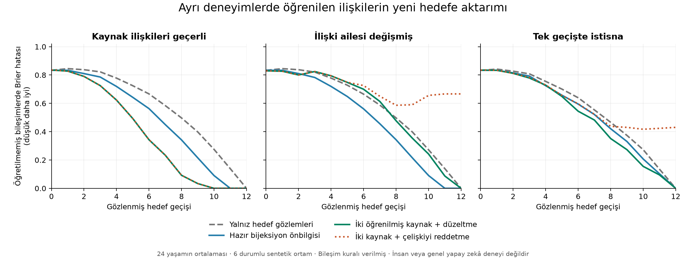

# Ayrı deneyimlerden ilişki aktarımı ve yeni çıkarım

Muhammed Yasin Yılmaz · 22 Eylül 2026 · Araştırma turu 12 · Yerel araştırma kaydı

## Ana sonuç ve açık kalan problem

Kullanıcının ayrı gelişmiş bilgi kümelerinin ortak ilişkilerle birleşerek yeni öğrenmeyi kolaylaştırabileceği önerisi, **verilen bir ilişki dili içindeki sonlu bir modelde kısmen desteklendi**. İki ayrı kaynakta deneyimle öğrenilmiş ilişkiler, yeni adlarla sunulan uyumlu bir hedefte, doğrudan öğretilmemiş iki-adım sonuçların daha az hedef gözlemiyle doğru hesaplanmasını sağladı. Aynı kaynakların yanlış hedefe aktarılması ise kesin yanlış tahminler üretti. Çelişkiye rağmen yapıyı değiştirmeyen yöntem, bütün hedefi gözledikten sonra bile yanlış kaldı.

**Yaşarken öğrenmenin genel ilkesi veya genel yapay zekâ çözülmüş değildir.** Nesneleri ayırt etme, ilişki dilini oluşturma, bağlantının türünü keşfetme, değer/duygu, kavramların bölünüp yeniden birleşmesi ve sınırlı kaynakla açık uçlu gelişim bu deneyde çözülmedi. Bu tur, ana araştırmanın bir bileşenidir; onun yerine geçmez. Beyin verisi kullanılmadı.

## Kullanıcının açıklamasından deneye geçen soru

[İlk kavramsal gözlem](../living_learning_concepts_2026_09_22/OBSERVATION_AND_HYPOTHESES_TR.md) ve [çapraz bağlantı açıklaması](../living_learning_concepts_2026_09_22/CROSS_CONNECTIONS_AND_TRANSFER_TR.md) aynen korunuyor. Sınanan ayrım şudur:

1. Geçmişte olmuş tek bir olayı geri çağırmak.
2. Farklı deneyimlerde öğrenilmiş ilişkileri yeni bir bağlamda kullanarak görülmemiş bir sonuç çıkarmak.
3. Bu geçmiş sayesinde yeni hedefi daha az deneyimle öğrenmek.

Deneyde 2 ve 3 ölçüldü. Ham kaynak olaylarının tüm listesini saklamak gerekli değildi; onlardan edinilmiş geçiş yapısı saklandı. Bu, biyolojik bilinçli hatırlama ile örtük bellek ayrımının modeli sayılmıyor.

## Deney ve sınama düzeni

[Sonuç öncesi protokol](PROTOCOL.md), [matematiksel denetim](MATHEMATICAL_AUDIT_TR.md) ve [literatür karşılaştırması](LITERATURE_TR.md) ayrı dosyalardır. İlk protokol, başarım hesabından önce yazıldı; dış bir ön kayıt değildir. Donmuş kontrolün davranışı yine ilk çalıştırmadan önce açıklaştırıldı. Parametreler sonuçlara göre ayarlanmadı.

Her kaynakta altı durum ve tek eylem var. Kaynak A altı durumluk bir döngü, kaynak B üç ayrı ikili döngü oluşturuyor. Durum başına iki gözlemle her kaynak için 12 gerçekleşmiş geçiş ediniliyor. İkinci kopyalar bu gürültüsüz modelde ek bilgi taşımıyor; deneyim sayısına dahil ediliyor. Kaynak ve hedef adları bağımsız karışıyor; doğru kaynak–hedef nesne eşlemesi öğreniciye verilmiyor. Kaynakların ortak nesne kimliği yok.

Öğrenici gözlemlerden kurduğu kaynak tablosunun 720 yeniden adlandırmasını deneyip yinelenen yapıları eliyor. A için 120, B için 15 farklı hedef fonksiyonu kalıyor. Hedefteki her eylem A veya B olabilir; öğreniciye “biri mutlaka A, diğeri B” bilgisi verilmiyor. Adayların ağırlıkları yeni hedef geçişleriyle değişiyor. İki eylemin verilen ortak hedef durum alanı, bileşime hazır bir arayüz sağlıyor; bu arayüzün keşfedildiği iddia edilmiyor.

Hedef üç türlü: iki kaynak yapısının geçerli olduğu yeni bileşim; B'nin iki üçlü döngüyle değiştirildiği aile değişimi; B'nin yalnız bir kenarında istisna. Kaynaklar kendi ortamlarında her zaman doğru öğreniliyor. “İlgisiz kaynaklar” kontrolündeki kaynaklar da doğru; yalnız uyumlu hedefin kaynak aileleriyle farklılar. Aile değişimi rejiminde bu kontrolün kaynaklarından biri artık hedefle uyumludur; adı bütün rejimlerde anlamsal ilgisizlik ifade etmez.

24 yaşam × 3 rejim × 8 yöntem = **576 edinim yolu**. Her yolda 12 farklı hedef hücresi birer kez açılıyor. Sonuç verilmeden önceki tahmin kaydediliyor. Başlangıç ve her güncelleme sonrasında toplam **7.488 durum kaydı** var; bunlar bağımsız örnek sayısı değil. Aynı yaşamın yöntemleri ve rejimleri eşleştirilmiş. Çıkarım sınaması, altı başlangıçta `0→1` ve `1→0` olmak üzere 12 iki-adım sorgusudur. Bu bileşimler öğrenmeye etiket olarak verilmedi.

Hata ölçüsü Brier: altı olası sonuç üzerindeki kare olasılık hatalarının toplamı. Sıfır tam doğru, yanlış kesin tahmin iki verir. Başarı yüzdesi, eşit en yüksek olasılıklar arasında eşit şanslı seçimin beklenen doğruluğudur. Sayılar betimseldir; daha geniş dünya ailelerine ilişkin anlamlılık veya güven aralığı iddiası yoktur.

## Uyumlu hedefte sonuçlar

| Yöntem | Sonuç gelmeden ortalama hata | 6 gözlemden sonra bileşim hatası | 8 gözlemden sonra bileşim hatası | 8 gözlemden sonra beklenen doğruluk |
|---|---:|---:|---:|---:|
| Yalnız hedef tablosu | 0,833333 | 0,666667 | 0,497106 | %51,25 |
| Bütün bijeksiyonlar baştan verilmiş | 0,591667 | 0,562838 | 0,342014 | %66,32 |
| Yalnız öğrenilmiş A | 0,675000 | 0,631526 | 0,428530 | %62,67 |
| Yalnız öğrenilmiş B | 0,611343 | 0,532022 | 0,273148 | %74,77 |
| **İki öğrenilmiş kaynak** | **0,398479** | **0,343091** | **0,092231** | **%92,71** |
| Farklı yapılardan iki doğru kaynak | 0,920371 | 0,750482 | 0,582262 | %50,68 |
| İki kaynak, çelişkiyi reddetme | 0,398479 | 0,343091 | 0,092231 | %92,71 |
| Bütün döngü türleri baştan verilmiş | 0,531733 | 0,483121 | 0,240733 | %81,42 |

İki kaynaklı yöntemin sonuç gelmeden toplam ortalama hatası; tablo, iki tek-kaynak kontrolü, bijeksiyon önbilgisi ve bütün döngü türleri kontrolünden **24 yaşamın hepsinde daha düşük**. Ancak bu, her ara anda daha iyi demek değil: sekizinci gözlemde bileşim hatası bijeksiyon kontrolüne göre 23 yaşamda düşük, birinde yüksek. Sadece zayıf bir ezber tablosunu yenme sonucuna dayanılmıyor.

Betimleyici ek ölçümde bütün 12 bileşik sorgunun ilk kez hatasız hale geldiği hedef gözlemi sayısı, iki kaynakta ortalama **8,58** (7–10), bijeksiyon ve döngü kataloglarında **10,54** (10–11), yalnız tabloda **12**. Bunun karşılığında iki kaynaklı yöntem önce 24 kaynak gözlemi kullanıyor. Bu sonuç **hedef veri verimliliği**, toplam yaşam deneyiminden tasarruf garantisi değil. İki-kaynak/tek-kaynak karşılaştırması farklı kaynak bilgi miktarları içeriyor; eşit 24 gözlemli farklı-yapı kontrolü, gözlem sayısının tek başına yeterli olmadığını ayrıca gösteriyor.

## Negatif sonuçlar ve düzeltmenin bedeli

| Hedef | İki kaynak: sonuç öncesi hata | Bijeksiyon önbilgisi | Yalnız A | Çelişkiyi reddeden iki kaynak |
|---|---:|---:|---:|---:|
| Uyumlu | 0,398479 | 0,591667 | 0,675000 | 0,398479 |
| İlişki ailesi değişmiş | 0,745994 | 0,591667 | 0,683681 | 0,832221 |
| Tek geçişte istisna | 0,692425 | 0,746701 | 0,676736 | 0,623336 |

Aile değişiminde iki kaynak, bijeksiyon kontrolünden ve yalnız A'dan **24 yaşamın tamamında daha kötü**. İkinci bir doğru geçmiş bilgi, uyumsuz hedefe taşındığında öğrenmeyi yavaşlatabilir. Bu rejimde iki kaynaklı düzeltilebilir model, 288 sonuç-öncesi tahminde 15 kesin yanlış tahmin veriyor. Yerel istisnada bu sayı 13; uyumlu hedefte sıfır. “Kesin” model içinde en az `1−1e−12` olasılık demektir; gerçek dünyada garanti değildir.

Çelişkiyi kabul eden modelde, ilgili eylemin tüm adayları elenince **yalnız o eylem** hedef tablosuna dönüyor; diğer eylemin öğrenilmiş yapısı korunuyor. Bu geri dönüş de verilmiş bir yordamdır. Tam hedef kanıtı sonunda tüm düzeltilebilir yöntemler hatasız oluyor. Çelişkiyi reddeden kontrol, aile değişiminde son bileşim hatası **0,666667**, yerel istisnada **0,430556** ile bitiyor; iki rejimde de 24 yaşamın tamamında düzeltilebilir modelden kötü.

Önemli karşı sonuç: yerel istisnada çelişkiyi reddetmek, ilk 12 etiket öncesi ortalamada **0,623336** ile düzeltilebilir modelin **0,692425** değerinden daha iyi. Düzeltilebilir model bu ölçüde 7 yaşamda iyi, 2 eşit, 15 kötü. Çünkü tek istisna, geçerli kalan geniş yapıyla birlikte aynı eylemin tüm yapısal aktarımının bırakılmasına yol açabiliyor. Bu gözlem bir neden açıklaması önerir; ayrı nedensel ayrıştırma deneyi yapılmadı. Sonradan bilinen gerçeğe uyum ile hemen sonraki tahmin başarımı aynı ölçü değildir. Mevcut geri dönüşün en iyi düzeltme yöntemi olduğu gösterilmedi.

## Mevcut cevap aynıyken gelecekte öğrenme farklı olabilir

Sonuç sonrasında eklenen [tam kesirli tanık](../../../research/living_learning_relations_2026_09_22/results/structural_witness.json), yeni bir karşılaştırmalı başarım deneyi değildir. Protokoldeki A ve B ailelerinden şu ayrımı doğrular:

- Hedef kanıtı gelmeden A ve B'nin her tek-adım tahmini aynı: kendi durumuna dönüş olasılığı sıfır, diğer beş sonuca `1/5`.
- İkisine de aynı yeni olgu verilsin: `0→1`.
- A ailesinde `1→0` olasılığı sıfırdır; altılı döngü içinde ikili kapalı döngü olamaz.
- B ailesinde `1→0` olasılığı birdir; her bileşen ikili döngüdür.

Kanıt sonrası A'da 24, B'de 3 aday kalır. Başlangıçtaki tek-adım ortalama matrisi aynı olduğu halde güncelleme sonucu farklıdır. Aynı sıkıştırılmış duruma ve aynı yeni olguya uygulanan tek deterministik güncelleme iki farklı doğru sonucu veremez. **Yalnız mevcut ortalama tahminleri korumak, bu modelin gelecekteki öğrenme davranışını korumaya yetmez.** İlişkiler arasındaki ortak kısıtların veya eşdeğer ayırt edici bilginin de korunması gerekir.

Bu, embeddinglerin yetersizliğine ilişkin genel bir teorem değildir; uygun bir temsil bu yapıyı saklayabilir. Yeni bir bilimsel ilke keşfi iddiası da değildir. Önceki araştırmalardaki “aynı bugünkü davranış, farklı yarınki öğrenme” ayrımına ayrı bir sonlu yapısal tanık ekler. Kullanıcının aktif hatırlamada olmayan deneyimin etkisini sürdürmesi fikrine hesaplama düzeyinde bir örnek sağlar; beyin mekanizmasını doğrulamaz.

## Hipotezlerin durumu

| Hipotez | Bu turdaki durum | Kapsam |
|---|---|---|
| H8: ayrı kaynaklar birlikte hedef edinimini kolaylaştırabilir | Uyumlu rejimde destek | Bütün rejimlere genellenmiyor; kaynak maliyeti farklı |
| H9: doğru eski bilgi uyumsuz hedefte yanlış kesinlik üretebilir | Destek | Verilen sonlu aday dili ve kapalı ön olasılık altında |
| H10: kaynak yapısını bilmek, doğru rol eşlemesini bilmekle aynı değil | Gizli eşleme girişi yok; ad değiştirme denetimi geçti | Doğru eşleme verilmiş ayrı oracle karşılaştırması yapılmadı; avantajların büyüklüğü ayrıştırılmadı |
| H11: ayrı ilişkiler doğrudan eğitilmemiş bileşimleri destekleyebilir | Destek | Bileşim kuralı ve ortak hedef arayüzü verilmiş |
| H12: mevcut çıktı eşitliği, gelecek öğrenme eşitliği değildir | Sonuç sonrası kesin tanık | Ortalama tahmine indirgenen durum için; tüm temsillere imkânsızlık iddiası yok |

## Hesaplama ve kalıcılık maliyeti

| Yöntem | Kaynak gözlemi | Yeniden adlandırma girişimi | Farklı aday tablosu | Uyumlu hedefte ortalama mantıksal filtre kontrolü | Son durumda ortalama JSON baytı |
|---|---:|---:|---:|---:|---:|
| Tablo | 0 | 0 | 0 | 0 | 311 |
| Bijeksiyon önbilgisi | 0 | 0 | 720 | 1.746 | 35.613 |
| Yalnız A | 12 | 720 | 120 | 304 | 6.215,08 |
| Yalnız B | 12 | 720 | 15 | 40,92 | 1.052 |
| İki kaynak | 24 | 1.440 | 135 | 344,92 | 6.959 |
| Farklı iki kaynak | 24 | 1.440 | 184 | 446,42 | 8.815,25 |
| Bütün döngü türleri | 0 | 0 | 720 | 1.746 | 35.998 |

Filtre sayacı yalnız o anda aktif adayların mantıksal sınamalarını sayar. NumPy uygulaması bir sütunu bütün adaylar için karşılaştırır; bu sayaç gerçek vektör işlemi, FLOP veya CPU süresi değildir. Başlangıç aday üretimi, sıralama, olasılık hesapları ve araştırma değerlendirmeleri bu hedef filtresi sayacına dahil değil. Kaynak aday üretimi ayrı raporlandı. Hazır katalogların önbilgisi bedelsiz doğal öğrenme sayılmıyor; oluşturma süresi ölçülmedi. JSON boyutu tam süreç RAM'i değil. Saklanan kaynak tabloları ve aday ilişkiler, ham kaynak olay dizisi olmadan kalıcı öğrenici durumunun içinde bulunuyor.

## Doğrulamalar ve tekrar üretim

- 120/15/40/144 kaynak sınıfı büyüklükleri, bağımsız döngü sınıflamasıyla doğrulandı; katalogdaki 11 tür toplam 720 fonksiyonu kapsıyor.
- Eksik kaynak kenarı olan 24 durumda eksik bilgi gizli kaynaktan tamamlanmadı; kaynak çıkarımı reddedildi.
- Kaynak adları ve kayıt sırası, hedef nesneleri ve eylemleri değiştirildi. 312 durum noktasında dönüştürülmüş tahminler `1e−12` toleransıyla aynı kaldı.
- İki eylemin bileşim olasılığı, 12 ortak aday çifti üzerinden doğrudan hesapla doğrulandı; gerçek bileşim etiketleri 36 skaler sorguda ayrıca denetlendi.
- Aynı bilinmeyen eylemi iki kez uygulamada ortalama matrislerin çarpımının yanlışlığına karşı örnek doğrulandı. Deney bunu kullanmıyor.
- Sekiz yöntem × üç rejim = 24 ayrı süreçte yeniden başlatma; kalan gözlemler ve tahminler kesintisiz çalışan nesneyle tam aynı.
- 6.912 etiket-öncesi kayıt ve 7.488 değerlendirme kaydı denetlendi; 576 yolun ana çalıştırması baştan hesaplanıp JSON içeriği tam eşleşti.
- Önceden var olan **904 dosyanın** içeriği ve Git HEAD korundu. Kitap ve önceki olumlu/olumsuz sonuçlar değiştirilmedi. Commit/push/yayın yapılmadı.

Kod, çıktı dosyaları ve tekrar üretim komutları [deney README'sinde](../../../research/living_learning_relations_2026_09_22/README.md). [Son denetim kaydı](../../../research/living_learning_relations_2026_09_22/results/final_audit.json) kaynak/sonuç bağlarını ve dosya korumasını kaydeder. Bunlar yerel doğrulamalardır; dış hakem değerlendirmesi veya bağımsız araştırma tekrarı değildir.

## Geniş araştırmaya dönüş

Bu tur eski bilgiden sapmanın zamanına değil, **deneyimle edinilen yapının yeni bir hesaplamayı mümkün kılmasına** odaklandı. Ancak verilen dilde daha iyi çıkarım, sistemin kendi temsil dilini geliştirmesiyle aynı değildir. Ana problem için [yeni araştırma haritası](NEXT_HYPOTHESES_TR.md) dört ayrı açık yükümlülüğü korur: kavram sınırlarının oluşması/değişmesi, yeni ilişki türlerinin ve ortak arayüzün öğrenilmesi, geçmiş etkisini koruyan fakat değiştirilebilir kalıcı durum, sonlu bütçede yeni hesaplama yollarının edinimi. Bir sonraki tur yalnız buradaki yöntemi iyileştirmek zorunda değildir.
